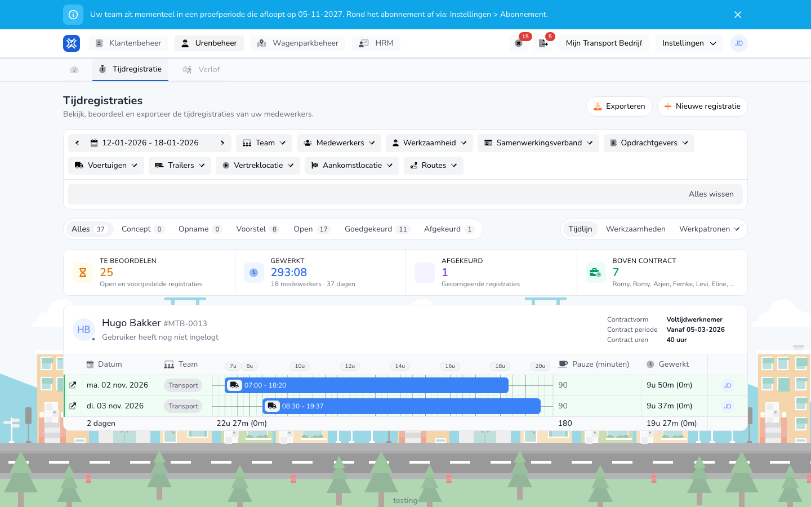

{/* translated-from: nl/management/hour-management/time-registrations/details.mdx sha256:8ed8136c5942e785c17ee72fbc2cff0204338bc8b6f35846c29b3ba508aaf4fa */}

## Do czego służy ta strona

Strona szczegółów otwiera się po otwarciu istniejącej rejestracji. Tam sprawdza się pełną zawartość jednej rejestracji.

## Co można tutaj zrobić

- Przeczytać całą rejestrację.
- Sprawdzić, czy rejestracja jest poprawna, zanim zostanie zmieniona lub poddana dalszym działaniom.

## Zrzut ekranu

## Co widać na stronie

- Istniejącą rejestrację otwartą z przeglądu.
- Kontekst okresu, pracownika i szczegółów rejestracji.

## Jak korzystać z tej strony

1. Najpierw otworzyć istniejącą rejestrację z przeglądu.
2. Sprawdzić pracownika, datę i zawartość rejestracji.
3. Przejść do edycji tylko wtedy, gdy naprawdę trzeba coś zmienić.

## Co dzieje się potem

- Wiadomo, czy rejestracja jest kompletna i poprawna.
- Następnie można w razie potrzeby przejść do edycji lub osi czasu.

## Warto wiedzieć

- W praktyce jako punktu wyjścia należy zawsze używać istniejącej rejestracji z przeglądu.

## Powiązane strony

- Przegląd rejestracji czasu pracy
- Edycja rejestracji czasu pracy
- Oś czasu rejestracji czasu pracy

