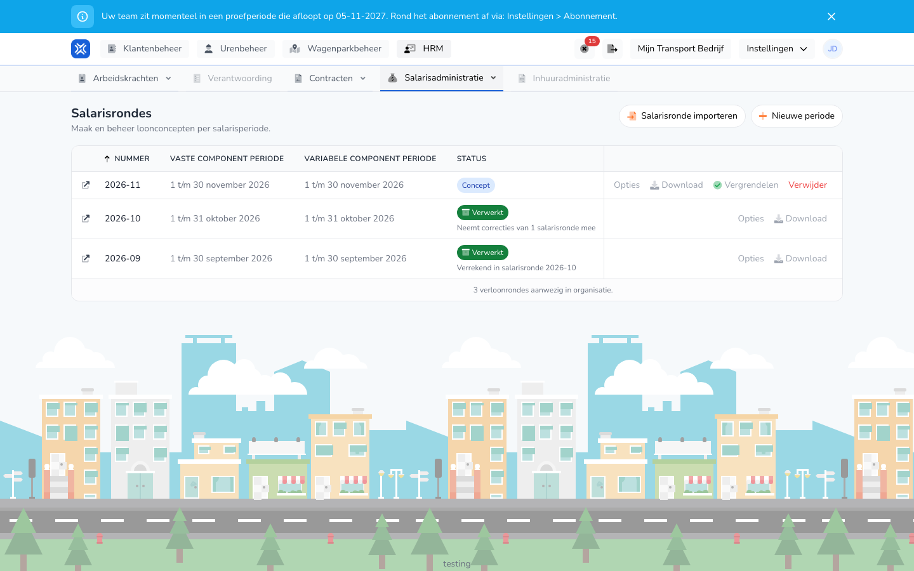

{/* translated-from: nl/management/human-resources/payroll-runs/overview.mdx sha256:05ac2c05a7be3b86b8cd95b8d5d4be04086c5a41eb5ebf7394d77dc2f02203b9 */}

## Do czego służy ta strona

Tutaj widać wszystkie naliczenia płac organizacji, z okresem płacowym i statusem każdego naliczenia. Z tego przeglądu tworzy się nowe naliczenie, przetwarza naliczenie i pobiera eksporty.

## Zrzut ekranu

## Kto może z tego korzystać

- Administrator z pełnymi uprawnieniami w organizacji.
- Organizacja potrzebuje modułu **Zmienne składniki płac**. Bez tego modułu **Naliczenia płac** nie ma w menu.

## Jak korzystać z tej strony

1. Otworzyć **HR** i wybrać **Administracja płac**.
2. Kliknąć **Naliczenia płac**.
3. Znaleźć naliczenie w przeglądzie. Najnowsze naliczenie jest na górze.
4. Użyć przycisków w wierszu naliczenia. **Opcje** i **Pobierz** otwierają listę wyboru.
5. Kliknąć ikonę przed numerem, aby otworzyć szczegóły naliczenia.
6. Kliknąć **Nowy okres**, aby utworzyć naliczenie. Zob. [Tworzenie naliczenia płac](/pl/management/human-resources/payroll-runs/create).

## Pola

Przegląd nie ma filtrów. Każdy wiersz pokazuje:

| Kolumna | Znaczenie |
|-------|-----------|
| **Numer** | Numer naliczenia, na przykład 2026-10. |
| **Okres składników stałych** | Okres stałych składników wynagrodzenia. |
| **Okres składników zmiennych** | Okres zmiennych składników wynagrodzenia. |
| **Status** | Na jakim etapie jest naliczenie, zob. niżej. |
| **Ostatnio wykonano** | Kiedy naliczenie było ostatnio obliczane. |

Naliczenie ma jeden z tych statusów:

| Status | Znaczenie |
|--------|-----------|
| **Wersja robocza** | Naliczenie zostało obliczone i można je jeszcze zmieniać. |
| **W trakcie** | Trwa zadanie, takie jak obliczenie lub analiza. Procent rośnie na bieżąco. |
| **Zablokowane** | Naliczenie jest zablokowane i gotowe do zakończenia. |
| **Przetworzone** | Naliczenie zostało przetworzone. |
| **Skorygowane** | Po przetworzeniu znaleziono różnicę. Zob. [Korekty](/pl/management/human-resources/payroll-runs/corrections). |
| **Nieudane** | Zadanie się nie powiodło. |

Pod statusem może też widnieć:

- `Neemt correcties van 1 salarisronde mee`: to naliczenie przeniosło korektę starszego naliczenia.
- `Verrekend in salarisronde` z numerem: korekta tego naliczenia została wypłacona w tym nowszym naliczeniu. Tekst jest linkiem do tego naliczenia.

Przyciski w wierszu zależą od statusu:

| Przycisk | Kiedy |
|------|---------|
| **Opcje** → **Uruchom ponownie** | Przy wersji roboczej. |
| **Opcje** → **Odblokuj** | Przy zablokowanym naliczeniu. |
| **Opcje** → **Analizuj pod kątem korekt** | Przy przetworzonym lub skorygowanym naliczeniu. |
| **Zablokuj** | Przy wersji roboczej. |
| **Zakończ** | Przy zablokowanym lub skorygowanym naliczeniu. Zob. [Przetwarzanie naliczenia płac](/pl/management/human-resources/payroll-runs/process). |
| **Pobierz** | Pokazuje eksporty gotowe dla naliczenia. Zob. [Eksporty naliczenia płac](/pl/management/human-resources/payroll-runs/exports). |
| **Usuń** | Przy wersji roboczej lub zablokowanym naliczeniu. |

## Co dzieje się potem

- Przegląd odświeża się sam, dopóki trwa zadanie.
- **Zablokuj** najpierw prosi o potwierdzenie w oknie **Zablokuj naliczenie płac**. Następnie naliczenie jest przeliczane ponownie i otrzymuje status **Zablokowane**.
- **Usuń** najpierw prosi o potwierdzenie w oknie **Usuń naliczenie płac**.

## Ograniczenia

- Zablokowanego naliczenia nie można usunąć. Najpierw należy je odblokować przez **Opcje** → **Odblokuj**.
- Przetworzonego ani skorygowanego naliczenia nie można usunąć.
- Dopóki trwa zadanie naliczenia, należy poczekać na jego zakończenie, zanim rozpocznie się nowe działanie na tym naliczeniu.
- Za pomocą **Importuj naliczenie płac** wstawia się wcześniej wykonany eksport zmiennych składników płac (.xlsx) jako wynik naliczenia. Godziny nie są wtedy obliczane ponownie.
