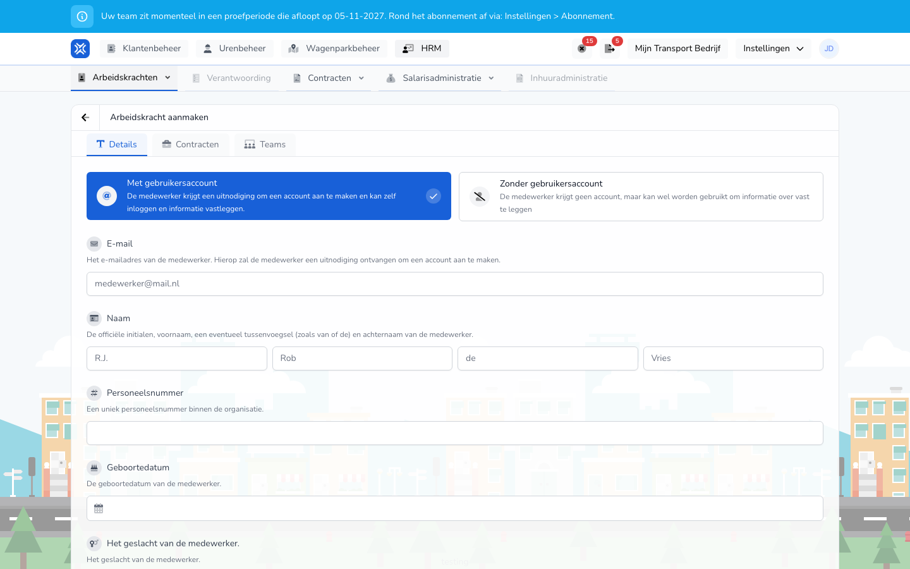

{/* translated-from: nl/management/human-resources/workers/create.mdx sha256:8d78ca5888212ea402f49b6fb16792721a6700ec7648e46cc3d536af1b3b6521 */}

import { Hint } from '/snippets/hint.jsx';

## Do czego służy ta strona

Tutaj dodaje się pracownika: osobę, umowę i zespoły, do których pracownik należy.

## Zrzut ekranu

## Kto może z tego korzystać

- Administrator lub menedżer organizacji.

## Jak korzystać z tej strony

1. Otworzyć **HR** → **Pracownicy** i kliknąć **Nowy pracownik**.
2. Na karcie **Szczegóły** wybrać, czy pracownik otrzyma konto: `Met gebruikersaccount` lub `Zonder gebruikersaccount`.
3. Wypełnić dane osoby.
4. Otworzyć kartę **Umowy**, kliknąć `+` i wypełnić umowę.
5. Otworzyć kartę **Zespoły** i zaznaczyć zespoły.
6. Kliknąć **Nowy pracownik**.

## Pola

Karta **Szczegóły**:

| Pole | Co należy wpisać |
|------|--------------|
| `Met gebruikersaccount` / `Zonder gebruikersaccount` (wymagane) | Z kontem pracownik może sam się logować i zapisywać dane. Bez konta zapisuje się tylko dane o pracowniku. |
| **E-mail** | Tylko z kontem, i wtedy wymagane. Na ten adres pracownik otrzymuje zaproszenie. |
| **Nazwa** (wymagane) | Inicjały, imię, ewentualnie przedrostek i nazwisko. Przedrostek nie jest wymagany. |
| **Numer pracownika** | Unikalny numer w organizacji. |
| **Data urodzenia** | Data urodzenia. |
| Płeć | **Mężczyzna**, **Kobieta** lub **Inne**. |
| **Kod kierowcy w tachografie** | Kod karty kierowcy. <Hint kind="grey">To pole, **Adres zamieszkania** i **Lokalizacje** są widoczne, jeśli w organizacji włączona jest telematyka.</Hint> |
| **Adres zamieszkania** | Adres zamieszkania. |
| **Lokalizacje** | Dla każdego rodzaju lokalizacji, takiego jak `Standplaatsen` i `Kantoren`, które lokalizacje dotyczą tego pracownika. |

Karta **Umowy**, dla każdej umowy:

| Pole | Co należy wpisać |
|------|--------------|
| **Zatrudnienie** (wymagane) | **Pracownik**, **ZZP (samozatrudniony)** lub **Podwykonawca**. |
| **Początek** (wymagane) | Data rozpoczęcia umowy. |
| **Koniec** | Data zakończenia umowy. Puste oznacza umowę bezterminową. |
| **Rodzaj umowy** | Przy pracowniku: **Pracownik na wezwanie**, **Pracownik w niepełnym wymiarze czasu pracy** lub **Pracownik w pełnym wymiarze czasu pracy**. |
| **Typ godzin umowy** | **Stałe godziny** lub **Godziny min-max**. |
| **Godziny umowy** | Liczba godzin tygodniowo. <Hint kind="yellow">Pracownik w pełnym wymiarze czasu pracy ma zawsze 40 godzin, pracownik na wezwanie 0. To, co godziny oznaczają dla obliczania wynagrodzenia, zależy od układu zbiorowego (CAO) lub ustawienia umowy.</Hint> |

Karta **Zespoły**: zaznaczyć zespoły. Za pomocą **Zaznacz wszystko** wybiera się wszystkie zespoły. Wybiera się spośród zespołów, którymi się zarządza, i co najmniej jeden.

## Co dzieje się potem

- Następuje powrót do przeglądu z nowym pracownikiem.
- Z kontem pracownik otrzymuje e-mail z **Przyjmij zaproszenie**. Dopóki zaproszenie nie zostanie przyjęte, jest ono widoczne w [Zaproszenia](/pl/management/human-resources/workers/invitations).

## Ograniczenia

- Pracownik potrzebuje co najmniej jednej umowy. Umowy nie mogą na siebie zachodzić.
- Adresu e-mail, który ma już otwarte zaproszenie lub już należy do organizacji, nie można użyć ponownie.
