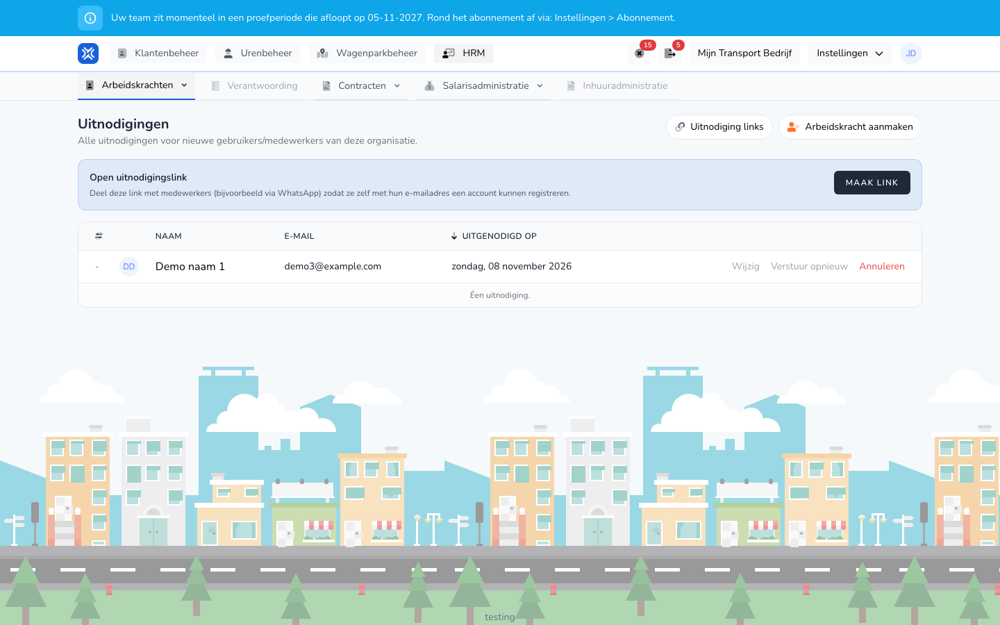

{/* translated-from: nl/management/human-resources/workers/invitations.mdx sha256:8560644f52ce4ae6d97becb6b8bea22bc0cc2497c2921d3d484a1a442040a208 */}

import { Hint } from '/snippets/hint.jsx';

## Do czego służy ta strona

Tutaj widać, kto otrzymał zaproszenie i jeszcze go nie przyjął. Zaproszenie można wysłać ponownie, wycofać albo utworzyć link, za pomocą którego osoby same zakładają konto.

## Zrzut ekranu

## Kto może z tego korzystać

- Administrator lub menedżer organizacji.

## Jak korzystać z tej strony

Wysłanie zaproszenia:

1. Utworzyć pracownika z opcją `Met gebruikersaccount` i **E-mail**. Zob. [Tworzenie pracownika](/pl/management/human-resources/workers/create).
2. Zaproszenie od razu trafia na ten adres e-mail.

Otwarte zaproszenia:

1. Otworzyć **HR** → **Pracownicy** i kliknąć **Zaproszenia**.
2. Kliknąć **Wyślij ponownie**, aby jeszcze raz wysłać e-mail.
3. Kliknąć **Anuluj**, aby wycofać zaproszenie, i potwierdzić przyciskiem **Usuń**.
4. Kliknąć **Edytuj**, aby zmienić pracownika, na przykład błędny adres e-mail.

Otwarty link zaproszeniowy:

1. Przy **Otwarty link zaproszeniowy** kliknąć **Utwórz link**.
2. Kliknąć **Kopiuj** i udostępnić link, na przykład przez WhatsApp.
3. Każdy, kto ma link, zakłada konto samodzielnie, używając własnego adresu e-mail. <Hint kind="red">Każdy, kto ma link, może zgłosić się do organizacji. Link należy wycofać, jeśli nie jest już używany.</Hint>
4. W sekcji **Linki z zaproszeniem** widać wszystkie aktywne linki. Za pomocą **Kopiuj link** ponownie kopiuje się link, za pomocą **Unieważnij** wyłącza się go.

## Pola

| Kolumna | Znaczenie |
|-------|-----------|
| **Nazwa** | Imię i nazwisko pracownika. |
| **E-mail** | Adres, na który poszło zaproszenie. |
| **Zaproszono** | Kiedy zaproszenie zostało wysłane. |

## Co dzieje się potem

- Pracownik otrzymuje e-mail z przyciskiem **Przyjmij zaproszenie**. Po przyjęciu zaproszenie znika z listy.
- W przeglądzie przy pracowniku z otwartym zaproszeniem w sekcji **Akcje** widnieje także `Kopier uitnodiging`.

## Ograniczenia

- Zaproszenie można przyjąć tylko kontem z tym samym adresem e-mail.
- Wycofane zaproszenie już nie działa. Jeśli mimo to pracownik ma zostać zaproszony, należy zmienić adres e-mail przez **Edytuj**.
