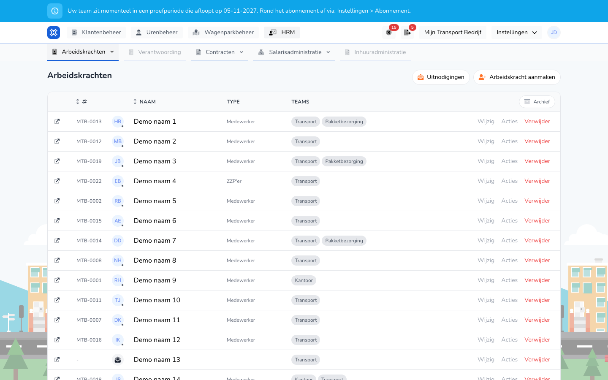

{/* translated-from: nl/management/human-resources/workers/overview.mdx sha256:629d4cf0cedc554799d3a0dd9d2c3cde9099c080506260a000232beed05b452a */}

## Do czego służy ta strona

Tutaj przegląda się i zarządza pracownikami organizacji.

## Co można tutaj zrobić

- Przeglądać pracowników.
- Dodać nowego pracownika.
- Zmienić pracownika, otworzyć akcje lub usunąć.

## Zrzut ekranu

## Co widać na stronie

- Przycisk **Nowy pracownik**.
- Tabelę z nazwą, typem, godzinami umowy i końcem umowy.
- Działania takie jak **Edytuj**, **Akcje** i **Usuń**.

## Jak korzystać z tej strony

1. Otworzyć **Personel**.
2. Znaleźć potrzebnego pracownika.
3. Użyć **Edytuj**, aby zmienić dane.
4. Użyć **Nowy pracownik**, aby dodać kogoś nowego.

## Co dzieje się potem

- Zmiany są uwzględniane w przeglądzie pracowników.
- Nowi pracownicy pojawiają się potem na liście.

## Warto wiedzieć

- Szczególnie starannie należy sprawdzać dane umowy.
- Akcje w wierszu służą do wykonywania dalszych działań.

## Powiązane strony

- Dashboard
- Przegląd rozliczeń

