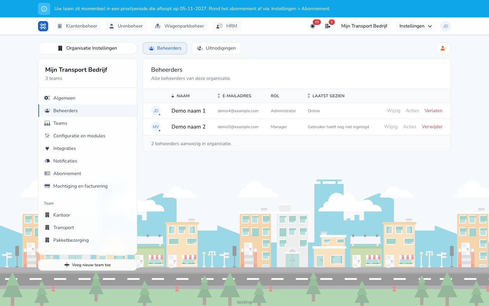

{/* translated-from: nl/settings/organization/administrators.mdx sha256:896eb6ae26f931a378b0cdf3ffa15127ae58ed53ed14ed87edfee89d7de02d59 */}

import { Hint } from '/snippets/hint.jsx';

## Do czego służy ta strona

Tutaj zarządza się tym, kto zarządza organizacją: administratorami i menedżerami. Pracowników, którzy tylko rejestrują godziny, zarządza się w [Pracownicy](/pl/management/human-resources/workers/overview).

## Zrzut ekranu

## Kto może z tego korzystać

- Administrator organizacji.

## Jak korzystać z tej strony

Zaproszenie kogoś:

1. Otworzyć **Ustawienia** → **Ustawienia organizacji** → **Administratorzy**.
2. Kliknąć przycisk z ikoną osoby z plusem w prawym górnym rogu.
3. Wpisać **E-mail**, wybrać **Rola** oraz, jeśli jest więcej zespołów, **Zespoły**.
4. Kliknąć **Zaproś**.

Zmiana lub usunięcie kogoś:

1. Na karcie **Administratorzy** kliknąć **Edytuj** w wierszu osoby.
2. W sekcji **Dane** zmienić **Pełne imię i nazwisko**, albo w sekcji **Uprawnienia** **Rola** i **Zespoły**, i kliknąć **Zapisz**.
3. Kliknąć **Usuń**, aby usunąć kogoś z organizacji, i potwierdzić.

## Pola

| Kolumna | Znaczenie |
|-------|-----------|
| **Nazwa** | Imię i nazwisko administratora lub menedżera. |
| **Adres e-mail** | Adres e-mail, którym osoba się loguje. |
| **Rola** | **Administrator** lub **Menedżer**. |
| **Ostatnio widziano** | **Online**, jak dawno osoba była aktywna, albo **Użytkownik jeszcze się nie zalogował**. |

Przy zaproszeniu:

| Pole | Co należy wpisać |
|------|--------------|
| **E-mail** (wymagane) | Adres, na który trafia zaproszenie. |
| **Rola** (wymagane) | **Administrator** lub **Menedżer**. |
| **Zespoły** | Zespoły, do których osoba ma dostęp. Co najmniej jeden. To pole widać, jeśli organizacja ma więcej niż jeden zespół. |

Co może rola:

| Rola | Co może ta rola |
|-----|------------------|
| **Administrator** | Zarządzać całą organizacją: wszystkimi ustawieniami, administratorami, subskrypcją i fakturami oraz wszystkim, co może menedżer. |
| **Menedżer** | Przeglądać, zatwierdzać, odrzucać, tworzyć i eksportować rejestracje czasu pracy, dla zespołów, do których należy menedżer. |

Pracownik nie otrzymuje tutaj roli. Pracownik tworzy własne rejestracje czasu pracy i otrzymuje konto, jeśli zostanie utworzony z kontem. Zob. [Tworzenie pracownika](/pl/management/human-resources/workers/create).

## Co dzieje się potem

- Zaproszenie znajduje się na karcie **Zaproszenia**, dopóki nie zostanie przyjęte. Tam można je **Wyślij ponownie** lub **Anuluj**.
- Po przyjęciu osoba znajduje się na karcie **Administratorzy**.
- Za pomocą **Opuść** we własnym wierszu samodzielnie opuszcza się organizację.
- Uprawnienia wynikają bezpośrednio z roli. Nie włącza się ani nie wyłącza pojedynczych uprawnień dla osoby.
- Za pomocą **Zespoły** ogranicza się menedżera do określonych zespołów. Jeśli wybrane zostaną wszystkie zespoły, rola obowiązuje w całej organizacji.

## Ograniczenia

- Organizacja zawsze zachowuje co najmniej jednego administratora. <Hint kind="red">Ostatniego administratora nie można usunąć.</Hint>
- Własnej roli i własnych zespołów nie można samodzielnie zmienić.
- Menedżer nie widzi menu **Ustawienia organizacji**.
- Adresu e-mail, który ma już zaproszenie lub już należy do organizacji, nie można zaprosić ponownie.
