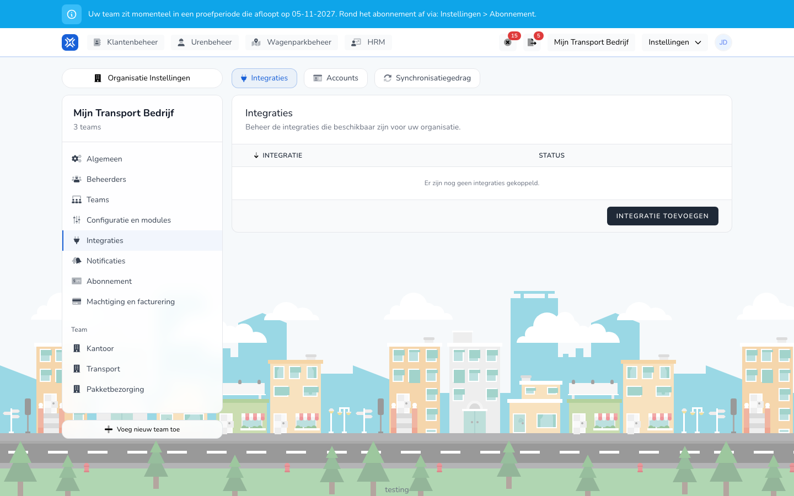

{/* translated-from: nl/settings/organization/integrations/instances.mdx sha256:8b8cba69127ca2c3727a68df43b6dcfb9cc4b01ce6206241f733fd04b1309be8 */}

import { Hint } from '/snippets/hint.jsx';

## Do czego służy ta strona

Na karcie **Integracje** łączy się TransportKlok z pakietem płacowym lub systemem telematycznym. Integracja korzysta z konta, które najpierw tworzy się w sekcji [Konta](/pl/settings/organization/integrations/accounts).

## Zrzut ekranu

## Kto może z tego korzystać

- Administrator lub menedżer organizacji.
- Integracja płacowa wymaga modułu **Zmienne składniki płac**. Integracja GPS wymaga modułu **Zarządzanie flotą**, z włączoną telematyką. <Hint kind="yellow">Jeśli telematyka nie jest włączona w organizacji, przy łączeniu widać komunikat: „Telematyka nie jest włączona dla tej organizacji. Włącz najpierw telematykę, zanim utworzysz integrację."</Hint>
- Integracje są w wersji beta. <Hint kind="grey">Widać je tylko wtedy, gdy organizacja uczestniczy w programie beta.</Hint>

## Jak korzystać z tej strony

1. Otworzyć **Ustawienia** → **Ustawienia organizacji** → **Integracje**.
2. Na karcie **Integracje** kliknąć **Dodaj integrację**.
3. Przy systemie kliknąć **Połącz**.
4. Wybrać **Konto**, wypełnić pozostałe pola, na przykład **Pracodawca** przy Nmbrs, i w polu **Nazwa** nadać integracji nazwę.
5. Kliknąć **Połącz**.
6. Na stronie ustawień wpisać to, czego potrzebuje system, i kliknąć **Zapisz ustawienia**.

## Pola

| Pole | Co należy wpisać |
|------|--------------|
| **Konto** | Konto, za pomocą którego integracja loguje się do systemu. |
| **Nazwa** | Nazwa w przeglądzie, na przykład nazwa spółki. |

To, czego wymaga i co robi każdy system, opisano na stronie tego systemu:

| Rodzaj | Systemy |
|-------|----------|
| Pakiet płacowy | [Nmbrs](/pl/management/human-resources/payroll-integrations/nmbrs), [Loket.nl](/pl/management/human-resources/payroll-integrations/loket), [AFAS Profit](/pl/management/human-resources/payroll-integrations/afas), [Exact Online](/pl/management/human-resources/payroll-integrations/exact-online) |
| Telematyka | [Webfleet](/pl/management/fleet-management/integrations/webfleet), [Samsara](/pl/management/fleet-management/integrations/samsara), [Geotab](/pl/management/fleet-management/integrations/geotab), [FleetGo](/pl/management/fleet-management/integrations/fleetgo), [Linqo](/pl/management/fleet-management/integrations/linqo), [CO3](/pl/management/fleet-management/integrations/co3), [Verizon Connect](/pl/management/fleet-management/integrations/verizon-connect) |
| TMS | [Qargo](/pl/management/customer-management/integrations/qargo) |

## Co dzieje się potem

- Integracja w przeglądzie ma status **Połączono**.
- To, jakie dane integracja pobiera lub wysyła, włącza się w [Zachowanie synchronizacji](/pl/settings/organization/integrations/capabilities).
- Jeśli brakuje uprawnień lub ustawień, widać komunikat z **Autoryzuj ponownie** lub **Otwórz ustawienia**.

## Ograniczenia

- Integrację odłącza się przyciskiem **Rozłącz**. Zaznaczenie **Rozłącz również powiązane konto OAuth.** powoduje, że usuwane jest także konto. <Hint kind="red">Odłączona integracja niczego już nie pobiera ani nie wysyła. Aby połączyć ponownie, należy utworzyć integrację od nowa.</Hint>
