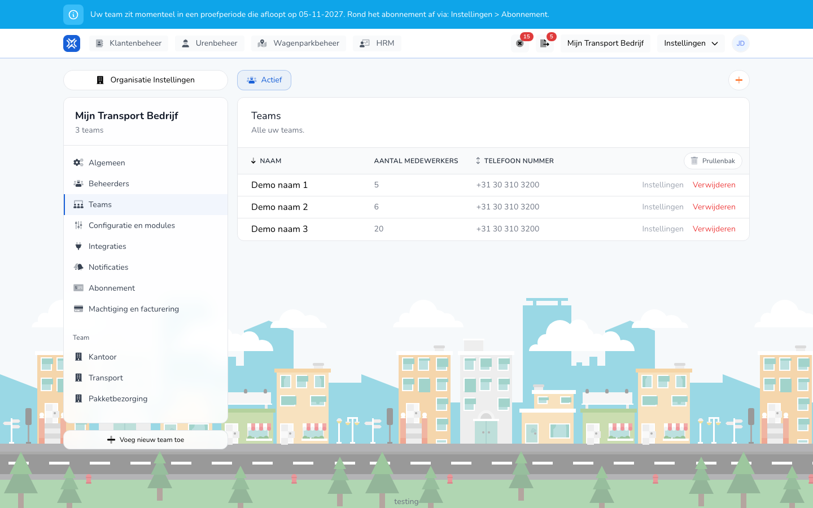

{/* translated-from: nl/settings/organization/teams.mdx sha256:8a9ba1e12d0cc8bfe243c78d3eec90361eb484a4ddeb1f7a73c47edf72e98fa1 */}

import { Hint } from '/snippets/hint.jsx';

## Do czego służy ta strona

Zespół to grupa pracowników z własnymi ustawieniami, takimi jak czynności i szablony. Tutaj tworzy się zespoły i otwiera ich ustawienia.

## Zrzut ekranu

## Kto może z tego korzystać

- Administrator organizacji.
- Zespoły są widoczne, jeśli organizacja ma więcej niż jeden zespół, a subskrypcja to **Plus** lub **Pro**. <Hint kind="yellow">Zespół można utworzyć, usunąć lub przywrócić przy aktywnej subskrypcji **Plus** lub **Pro** albo w okresie testowym.</Hint>

## Jak korzystać z tej strony

1. Otworzyć **Ustawienia** → **Ustawienia organizacji** → **Zespoły**.
2. Kliknąć **Ustawienia** w wierszu zespołu, aby otworzyć ustawienia zespołu.
3. Kliknąć **Dodaj nowy zespół**, aby utworzyć zespół. Wpisać **Nazwa** i kliknąć **Utwórz**.
4. Kliknąć **Usuń**, aby usunąć zespół, i potwierdzić w oknie **Usuń zespół**.

## Pola

| Kolumna | Znaczenie |
|-------|-----------|
| **Nazwa** | Nazwa zespołu. |
| **Liczba pracowników** | Ilu pracowników należy do zespołu. |
| **Numer telefonu** | Numer telefonu zespołu. |

Przy nowym zespole wpisuje się tylko **Nazwa**. Musi być unikalna w organizacji.

## Co dzieje się potem

- Po **Utwórz** następuje przejście do ustawień nowego zespołu. Zespół otrzymuje standardowe ustawienia układu zbiorowego (CAO) organizacji.
- Usunięty zespół znajduje się w **Kosz**. Za pomocą **Przywróć** można go odzyskać.

## Ograniczenia

- To, którzy pracownicy należą do zespołu, ustawia się przy pracowniku. Zob. [Zespoły pracownika](/pl/management/human-resources/workers/teams).
