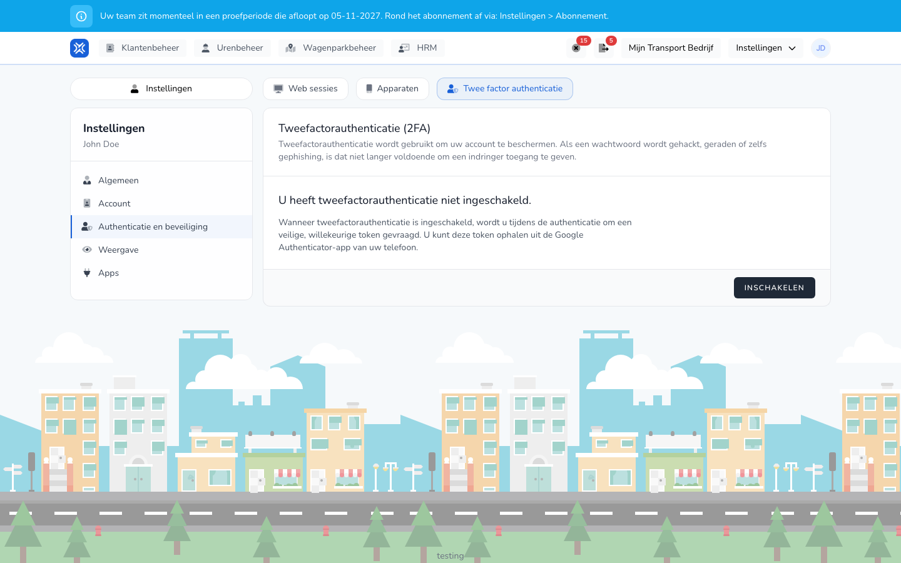

{/* translated-from: nl/settings/user/authentication-and-security/two-factor-authentication.mdx sha256:ccb27f71b5b08c80e9f6aad1ab3f90d680c5ab7c260da760e48ef48c21779625 */}

import { Hint } from '/snippets/hint.jsx';

## Do czego służy ta strona

Tutaj włącza się uwierzytelnianie dwuskładnikowe. TransportKlok prosi wtedy przy logowaniu także o kod z aplikacji na telefonie.

## Zrzut ekranu

## Kto może z tego korzystać

- Każdy użytkownik, dla własnego konta.

## Jak korzystać z tej strony

1. Kliknąć inicjały w prawym górnym rogu i wybrać **Ustawienia** → **Uwierzytelnianie i bezpieczeństwo**.
2. Otworzyć kartę **Uwierzytelnianie dwuskładnikowe** i kliknąć **Włącz**.
3. Zeskanować kod QR aplikacją uwierzytelniającą na telefonie, na przykład Google Authenticator. Albo skopiować **Klucz konfiguracji** do aplikacji.
4. Wpisać 6-cyfrowy **Kod uwierzytelniający** z aplikacji i kliknąć **Potwierdź konfigurację**.
5. Zachować kody odzyskiwania w bezpiecznym miejscu. <Hint kind="red">Za pomocą kodu odzyskiwania można wejść na konto po utracie telefonu. Bez kodu odzyskiwania nie jest to możliwe.</Hint>

## Pola

| Co widać | Znaczenie |
|------------|-----------|
| Status | Czy uwierzytelnianie dwuskładnikowe jest włączone. |
| **Pokaż kody odzyskiwania** | Pokazuje kody odzyskiwania. |
| **Wygeneruj ponownie kody odzyskiwania** | Tworzy nowe kody odzyskiwania. |
| **Pokaż kod QR** | Ponownie pokazuje kod QR. |
| **Wyłącz** | Wyłącza uwierzytelnianie dwuskładnikowe. |

## Co dzieje się potem

- Przy logowaniu TransportKlok prosi także o kod z aplikacji. Zob. [Logowanie z uwierzytelnianiem dwuskładnikowym](/pl/sign-in/two-factor).
- Po włączeniu następuje wylogowanie na pozostałych urządzeniach i w przeglądarkach. Potem loguje się tam ponownie z użyciem kodu.

## Ograniczenia

- Przed pokazaniem kodów odzyskiwania i kodu QR oraz przed wyłączeniem TransportKlok prosi najpierw o hasło.
