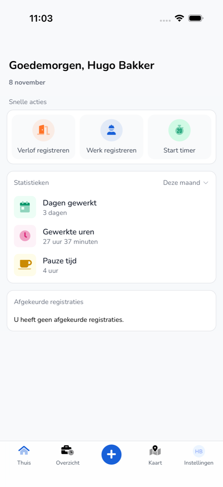

{/* translated-from: nl/workforce/app/home.mdx sha256:d3e31ca7eb3ad73d3658d65d9a53908d8f99b9935524291c537fc28361f2a3b3 */}

## Do czego służy ta strona

**Strona główna** to pierwszy ekran po zalogowaniu. Tutaj rozpoczyna się rejestrację i widać, ile przepracowano.

## Zrzut ekranu

## Kto może z tego korzystać

- Każdy pracownik korzystający z aplikacji.

## Jak korzystać z tej strony

1. Stuknąć u dołu **Strona główna**.
2. W sekcji **Szybkie działania** wybrać, co zrobić:
   - **Zarejestruj urlop**. Zob. [Rejestrowanie urlopu](/pl/workforce/app/register-leave).
   - **Zarejestruj pracę**. Zob. [Rejestrowanie pracy](/pl/workforce/app/register-work).
   - **Uruchom timer**. Zob. [Timer](/pl/workforce/app/timer).
3. W sekcji **Statystyki** wybrać okres, na przykład **Ten miesiąc**.
4. W sekcji **Odrzucone rejestracje** sprawdzić, czy pracodawca odrzucił rejestracje.

## Pola

| Element | Co widać |
|-----------|------------|
| **Dni przepracowane** | Liczba dni przepracowanych w wybranym okresie. |
| **Przepracowane godziny** | Przepracowane godziny w wybranym okresie. |
| **Czas przerwy** | Przerwy w wybranym okresie. |
| **Odrzucone rejestracje** | Odrzucone rejestracje albo komunikat „Nie masz odrzuconych rejestracji." |

U dołu znajduje się pasek menu:

| Przycisk | Co się tam robi |
|------|-----------------|
| **Strona główna** | Powrót do tego ekranu. |
| **Przegląd** | Rejestracje według tygodni. Zob. [Przegląd](/pl/workforce/app/overview). |
| `+` | Utworzenie nowej rejestracji. Zob. [Rejestrowanie pracy](/pl/workforce/app/register-work). |
| **Mapa** | Współpracownicy, pojazdy i naczepy na mapie. Zob. [Mapa](/pl/workforce/app/map). |
| **Ustawienia** | Profil, konto i bezpieczeństwo. Zob. [Ustawienia](/pl/workforce/app/settings). |

## Co dzieje się potem

- Odrzuconą rejestrację zmienia się w [Przegląd](/pl/workforce/app/overview).

## Ograniczenia

- Tutaj widać tylko własne godziny i rejestracje.
- **Uruchom timer** widać tylko wtedy, gdy organizacja uczestniczy w programie beta.
