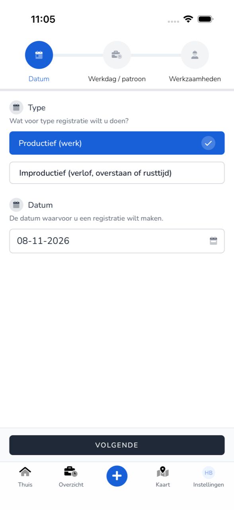
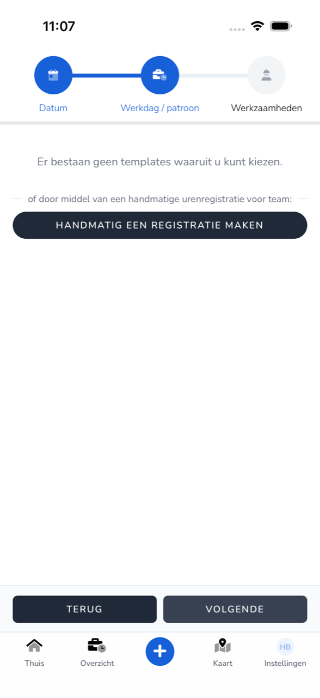
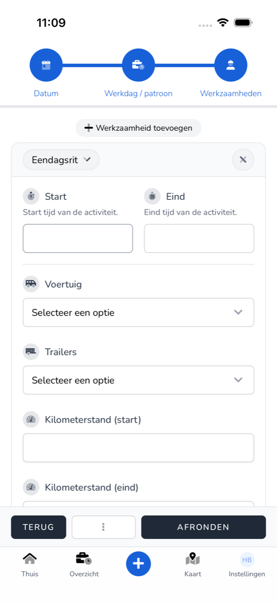

{/* translated-from: nl/workforce/app/register-work.mdx sha256:414f6947066e36516b2f0109ebf6a702ca3e8654cddc7529d89297ba620a3b0e */}

import { Hint } from '/snippets/hint.jsx';

## Do czego służy ta strona

Tutaj rejestruje się w aplikacji, co robiono danego dnia: czynności, godziny i dane kursu.

## Zrzut ekranu

## Kto może z tego korzystać

- Każdy pracownik korzystający z aplikacji.

## Jak korzystać z tej strony

1. Na **Strona główna** stuknąć **Zarejestruj pracę** albo u dołu `+`.
2. W polu **Typ** wybrać **Produktywne (praca)**.
3. Stuknąć **Data** i wybrać dzień. Stuknąć **Zapisz**, a następnie **Dalej**.
4. W polu **Dzień pracy / wzór** wybrać szablon albo stuknąć **Utwórz rejestrację ręcznie** i wybrać zespół. Stuknąć **Dalej**.
5. W sekcji **Czynności** stuknąć **Dodaj czynność** i wybrać, co robiono, na przykład **Kurs jednodniowy**.
6. Wypełnić pola czynności. W razie potrzeby dodać więcej czynności.
7. Wpisać **Przerwa (minuty)**, ewentualnie **Notatka**, i dodać **Podpis**.
8. Stuknąć **Zakończ**.

## Pola

| Pole | Co należy wpisać |
|------|--------------|
| **Typ** | **Produktywne (praca)** dla przepracowanych godzin. Dla urlopu wybiera się **Nieproduktywne**, zob. [Rejestrowanie urlopu](/pl/workforce/app/register-leave). |
| **Data** | Dzień rejestracji. W kalendarzu wybiera się **Dzień**, **Okres** lub pojedyncze **Dni**. |
| **Początek**, **Koniec** | Godzina rozpoczęcia i zakończenia czynności. |
| **Pojazd**, **Naczepy** | Pojazd i naczepy, którymi jechano. |
| **Stan licznika (początek)**, **Stan licznika (koniec)** | Stan licznika przy wyjeździe i przyjeździe. |
| **Numer kursu**, **Zatankowane paliwo**, **Zatankowany AdBlue**, **Opłaty drogowe** | Dane kursu. |
| **Notatka** | Uwaga do rejestracji. |
| **Przerwa (minuty)** | Przerwa w minutach. |
| **Podpis** | Podpis palcem. |

<Hint kind="grey">To, jakie pola są widoczne i które są wymagane, zależy od czynności i od tego, co pracodawca ustawił dla zespołu.</Hint>

## Co dzieje się potem

- Rejestracja znajduje się w [Przegląd](/pl/workforce/app/overview) i czeka na zatwierdzenie przez pracodawcę.
- Jeśli czegoś brakuje, pod polem widać, co jeszcze trzeba wypełnić, na przykład „Wpisz godzinę rozpoczęcia."

## Ograniczenia

- Jeśli nie wszystko jest gotowe, stuknąć `⋮` i **Zapisz jako szkic**. Za pomocą `Opnieuw beginnen` rozpoczyna się rejestrację od nowa.
- Jeśli okres płacowy tego dnia został już przetworzony, widoczny jest komunikat „Tej rejestracji nie można zmienić, ponieważ okres płacowy został już zatwierdzony lub przetworzony." <Hint kind="yellow">Należy wtedy skontaktować się z pracodawcą.</Hint>
