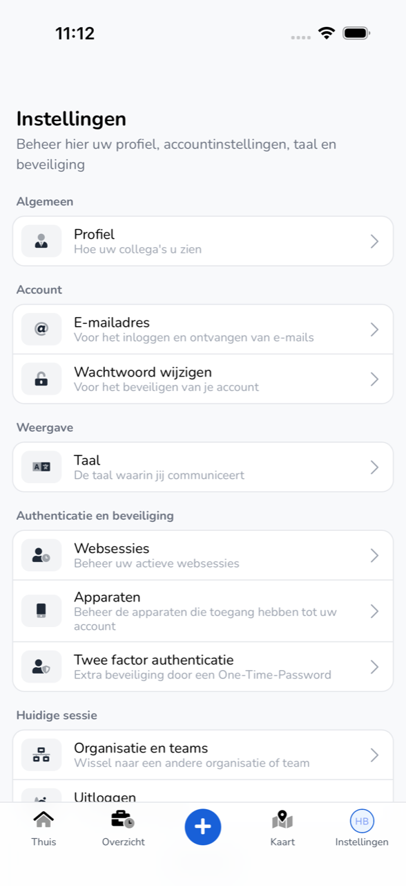
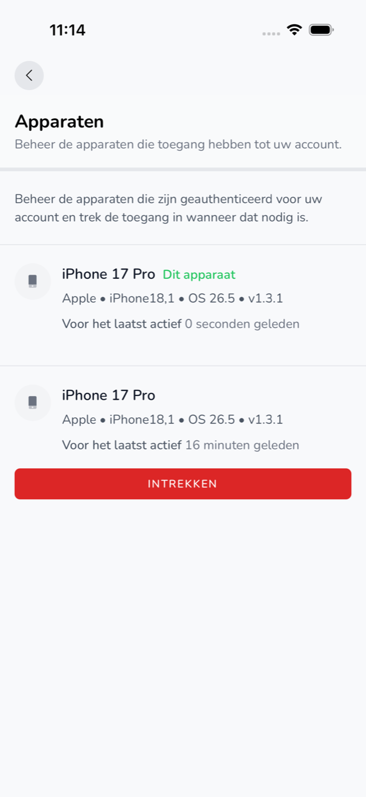

{/* translated-from: nl/workforce/app/settings.mdx sha256:c5a84b155d2486c3bd78343bb76d08c1966b85f750fc0c7d5f698368e0d7341f */}

import { Hint } from '/snippets/hint.jsx';

## Do czego służy ta strona

W **Ustawienia** zarządza się profilem, kontem, językiem aplikacji i bezpieczeństwem konta.

## Zrzut ekranu

## Kto może z tego korzystać

- Każdy pracownik korzystający z aplikacji.

## Jak korzystać z tej strony

1. Stuknąć u dołu **Ustawienia**.
2. Stuknąć element, który ma zostać zmieniony.
3. Zmienić go i stuknąć **Zapisz**.

## Pola

| Element | Co się tam robi |
|-----------|-----------------|
| **Profil** | Wybór lub usunięcie **Zdjęcie profilowe** oraz zmiana **Nazwa**. |
| **Adres e-mail** | Zmiana adresu e-mail, którym się logujesz. |
| **Zmień hasło** | Wpisanie i potwierdzenie **Bieżące hasło** i nowego **Hasło**. |
| **Język** | Wybór języka aplikacji: Nederlands, English, Deutsch, Polski lub Română. |
| **Sesje internetowe** | Za pomocą **Wyloguj z innych sesji przeglądarki** wylogowuje się wszędzie indziej. |
| **Urządzenia** | Telefony, które mają dostęp do konta. Za pomocą **Cofnij** usuwa się telefon. |
| **Uwierzytelnianie dwuskładnikowe** | Za pomocą **Włącz** włącza się uwierzytelnianie dwuskładnikowe. |
| **Organizacja i zespoły** | Wybór innej organizacji. Zob. [Organizacje i zaproszenia](/pl/workforce/app/organizations). |
| **Zastosuj aktualizację** | Uruchomienie teraz nowej, już pobranej wersji aplikacji. |
| **Wylogowanie** | Wylogowanie na tym telefonie. |

## Co dzieje się potem

- Po **Zapisz** zmiana jest od razu widoczna w aplikacji.
- Po **Wylogowanie** znów widoczne jest **Witamy z powrotem**.

## Ograniczenia

- Nowe hasło ma co najmniej 8 znaków, w tym co najmniej 1 wielką literę, 1 cyfrę i 1 znak specjalny.
- Dla **Sesje internetowe**, **Urządzenia** i **Uwierzytelnianie dwuskładnikowe** najpierw potwierdza się tożsamość za pomocą Face ID, Touch ID lub odcisku palca. <Hint kind="yellow">Jeśli nie skonfigurowano tego w telefonie, widoczny jest komunikat „Wymagana weryfikacja biometryczna" i nie można zmieniać tych elementów w aplikacji.</Hint>
- **Zastosuj aktualizację** widać tylko wtedy, gdy czeka nowa wersja.
