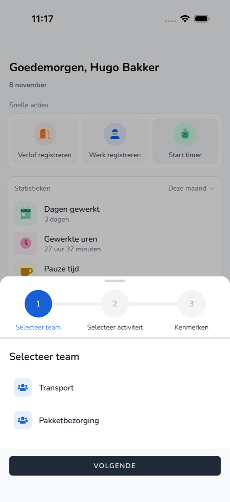

{/* translated-from: nl/workforce/app/timer.mdx sha256:bbcf1e5cd80cfec63ecccdececf01bce9eb074203a25f6146cafda5417818840 */}

import { Hint } from '/snippets/hint.jsx';

## Do czego służy ta strona

Za pomocą timera śledzi się pracę w trakcie jej wykonywania. Timer uruchamia się na początku i zatrzymuje po zakończeniu.

## Zrzut ekranu

## Kto może z tego korzystać

- Pracownicy organizacji uczestniczącej w programie beta. <Hint kind="grey">Jeśli organizacja nie uczestniczy, **Uruchom timer** nie jest widoczny.</Hint>

## Jak korzystać z tej strony

1. Na **Strona główna** stuknąć **Uruchom timer**.
2. W polu **Wybierz drużynę** wybrać zespół i stuknąć **Dalej**.
3. W polu **Wybierz aktywność** wybrać, co będzie robione, i stuknąć **Dalej**.
4. W sekcji **Cechy** ewentualnie wpisać **Notatka** i stuknąć **Uruchom**.

## Pola

| Przycisk | Co się dzieje |
|------|----------------|
| **Stop** | Timer zatrzymuje się, a czas staje się rejestracją. |
| **Zmień** | Zatrzymuje się bieżącą czynność i rozpoczyna inną. |
| **Edytuj dane** | Zmienia się dane trwającej czynności. |
| **Usuń** | Usuwa się trwającą rejestrację. |

## Co dzieje się potem

- Na **Strona główna** widoczna jest **Aktywne nagrywanie** z biegnącym czasem.
- Po **Stop** rejestracja znajduje się w [Przegląd](/pl/workforce/app/overview).

## Ograniczenia

- Jeśli timer został uruchomiony poza aplikacją, nie można go w aplikacji zmienić ani zatrzymać.
- Jeśli okres płacowy dzisiejszego dnia został już przetworzony, timer się nie uruchomi.
