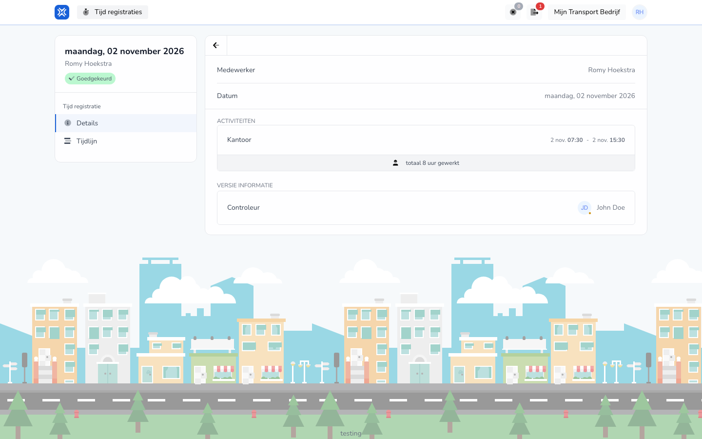

{/* translated-from: nl/workforce/hour-management/time-registrations/details.mdx sha256:7e34bd81d4100dc1226c633b2f917bc9bee9e93f97557dd87703f1f2d76384e8 */}

## Do czego służy ta strona

Na tej stronie przegląda się zawartość jednej istniejącej rejestracji.

## Co można tutaj zrobić

- Przeczytać rejestrację.
- Sprawdzić, czy wpisane dane się zgadzają.

## Zrzut ekranu

## Co widać na stronie

- Szczegóły jednej rejestracji.
- Wypełnione dane tej rejestracji.

## Jak korzystać z tej strony

1. Otworzyć istniejącą rejestrację z przeglądu.
2. Spokojnie przeczytać dane.
3. Przejść do edycji tylko wtedy, gdy trzeba coś zmienić.

## Co dzieje się potem

- Wiadomo, czy rejestracja się zgadza, czy trzeba ją jeszcze zmienić.

## Warto wiedzieć

- Ta strona służy przede wszystkim do kontroli.
- Zmieniać coś należy dopiero wtedy, gdy ma się pewność, co jest błędne lub się zmieniło.

## Powiązane strony

- Przegląd rejestracji czasu pracy
- Edycja rejestracji czasu pracy
- Oś czasu rejestracji czasu pracy

