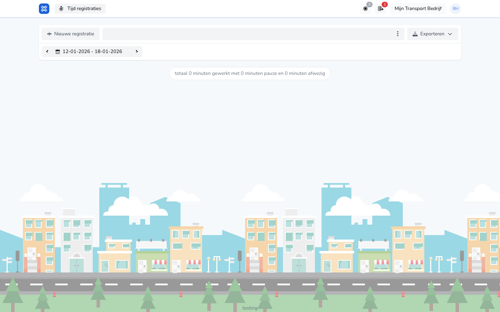

{/* translated-from: nl/workforce/hour-management/time-registrations/overview.mdx sha256:b3e5f1201fa9aeae533b47bfa3c8fae5be8a988fb9de9791bd6b19240aa0f4e0 */}

## Do czego służy ta strona

Tutaj widać własne rejestracje czasu pracy i rozpoczyna się nową rejestrację.

## Co można tutaj zrobić

- Przeglądać własne rejestracje.
- Utworzyć nową rejestrację.
- Zobaczyć łączną liczbę przepracowanych minut.

## Zrzut ekranu

## Co widać na stronie

- Przycisk **Nowa rejestracja**.
- Wybór okresu.
- Podsumowanie przepracowanych i nieobecnych minut.

## Jak korzystać z tej strony

1. Otworzyć przegląd rejestracji czasu pracy.
2. Najpierw sprawdzić, czy wybrany jest właściwy okres.
3. Użyć **Nowa rejestracja**, aby coś dodać.

## Co dzieje się potem

- Od razu widoczna jest aktualna suma dla wybranego okresu.
- Nowe rejestracje pojawiają się potem w tym przeglądzie.

## Warto wiedzieć

- Ten ekran służy do własnej rejestracji pracy.
- Zawsze sprawdzać, czy patrzy się na właściwy tydzień.

## Powiązane strony

- Tworzenie rejestracji czasu pracy
- Szczegóły rejestracji czasu pracy

