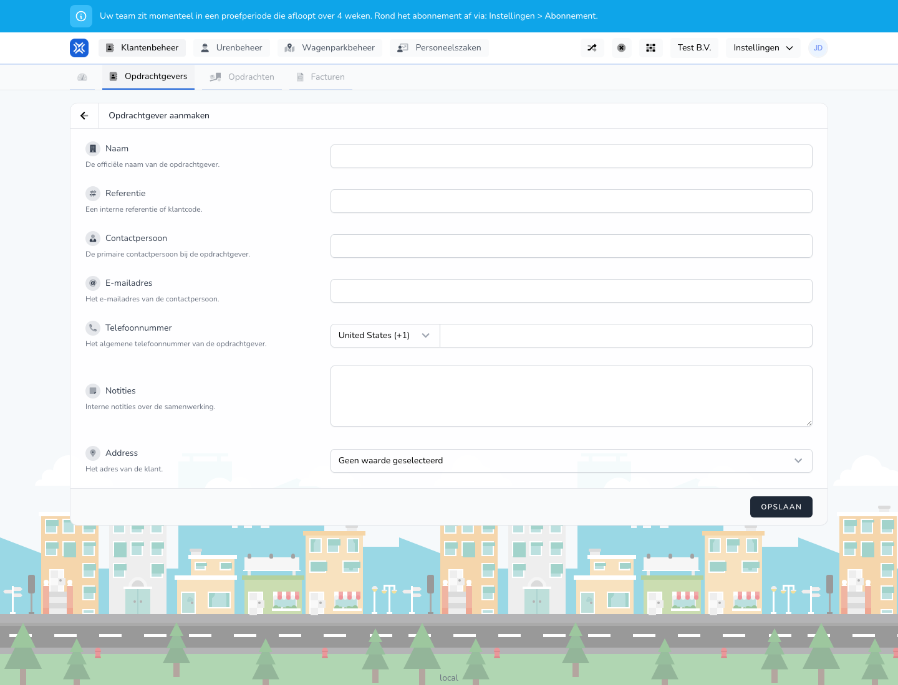

{/* translated-from: nl/management/customer-management/customers/create.mdx sha256:f5b32cca0d6759ecf68af1b74403b567bb768ac17f85e6c013a8ef59f691f2ba */}

## Pentru ce este această pagină

Cu acest formular adăugați un client nou.

## Ce puteți face aici

- Completați numele, referința și datele de contact.

## Captură de ecran

## Ce vedeți pe pagină

- Câmpuri pentru nume, referință, persoană de contact, adresă de e-mail și număr de telefon.

## Cum folosiți această pagină

1. Deschideți **Client nou**.
2. Completați denumirea oficială.
3. Adăugați referința internă, dacă o folosiți.
4. Completați persoana de contact și datele de contact.
5. Salvați clientul.

## Ce se întâmplă după aceea

- Clientul apare în prezentarea generală.
- Puteți folosi apoi acest client în alte procese.

## Important de știut

- Folosiți date de contact pe care le pot folosi direct și colegii.
- Verificați cu atenție suplimentară adresa de e-mail și numărul de telefon.

## Pagini conexe

- Prezentarea generală a clienților
- Modificarea unui client

