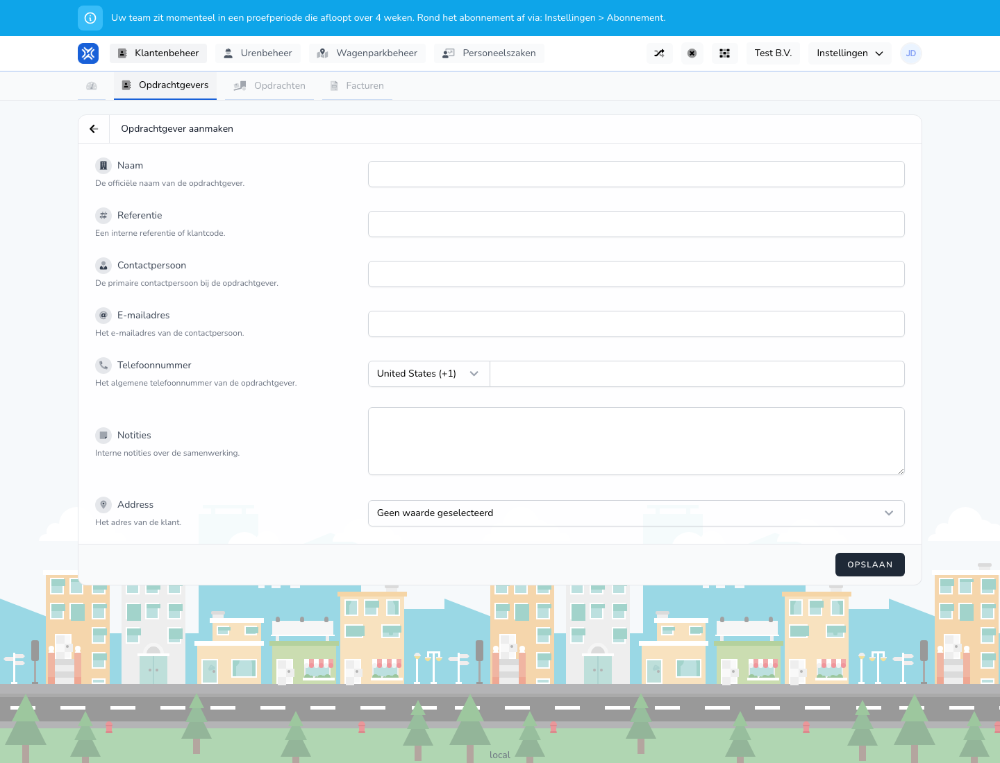

{/* translated-from: nl/management/customer-management/customers/edit.mdx sha256:71c8ffe062178869381f77ad24b55679c91e0a6a3a5152079a1b450b9033666f */}

## Pentru ce este această pagină

Cu această pagină modificați datele unui client existent. Câmpurile seamănă cu cele din pagina de creare.

## Ce puteți face aici

- Actualizați numele, referința și datele de contact.

## Captură de ecran

## Ce vedeți pe pagină

- Un formular cu aceleași câmpuri principale ca la creare.

## Cum folosiți această pagină

1. Deschideți un client existent din prezentarea generală.
2. Modificați datele care s-au schimbat.
3. Verificați încă o dată datele de contact.
4. Salvați modificările.

## Ce se întâmplă după aceea

- Datele modificate sunt folosite în prezentarea generală și în procesele asociate.

## Important de știut

- În practică, folosiți prezentarea generală ca punct de plecare pentru a deschide un client real.

## Pagini conexe

- Prezentarea generală a clienților
- Crearea unui client

