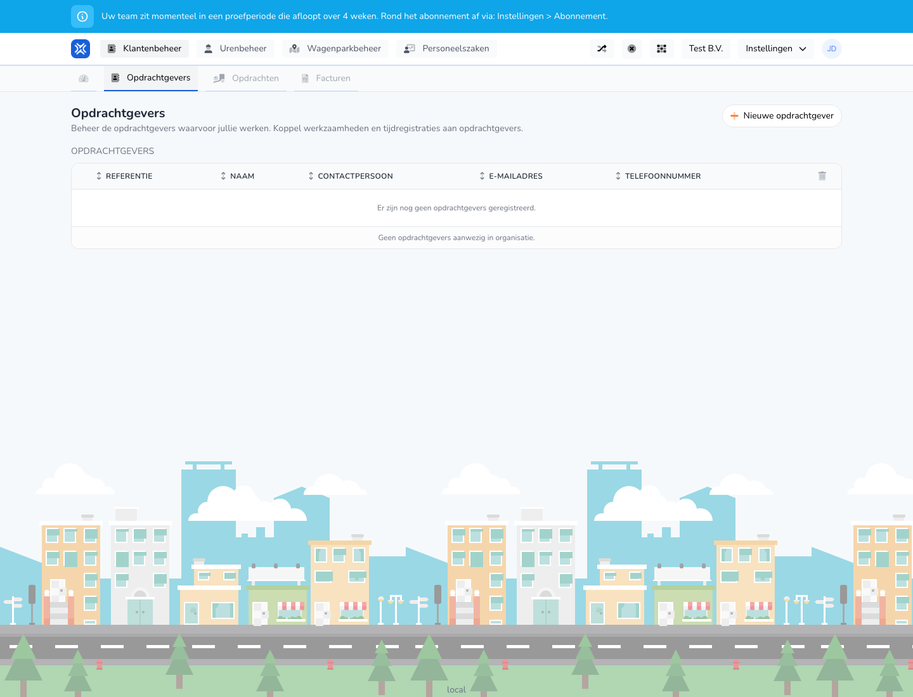

{/* translated-from: nl/management/customer-management/customers/overview.mdx sha256:a947049eb1769c342445e10a1e6d1860d86fa2ab46aea812de195d6886edae51 */}

## Pentru ce este această pagină

Aici gestionați clienții pentru care lucrează organizația dumneavoastră.

## Ce puteți face aici

- Vizualizați clienții.
- Adăugați un client nou.
- Deschideți clienții existenți pentru alte acțiuni.

## Captură de ecran

## Ce vedeți pe pagină

- Butonul **Client nou**.
- Un tabel cu referință, nume, persoană de contact, adresă de e-mail și număr de telefon.
- O explicație deasupra tabelului.

## Cum folosiți această pagină

1. Deschideți **Clienți**.
2. Verificați mai întâi dacă clientul există deja.
3. Folosiți **Client nou** dacă doriți să adăugați o relație nouă.

## Ce se întâmplă după aceea

- Clienții noi apar în prezentarea generală.
- Clienții existenți pot fi folosiți ulterior în înregistrările timpului de lucru și în alte procese.

## Important de știut

- Lucrați cu atenție aici, deoarece clienții pot fi aleși și în alte părți.
- Verificați cu atenție datele de contact.

## Pagini conexe

- Crearea unui client
- Modificarea unui client

