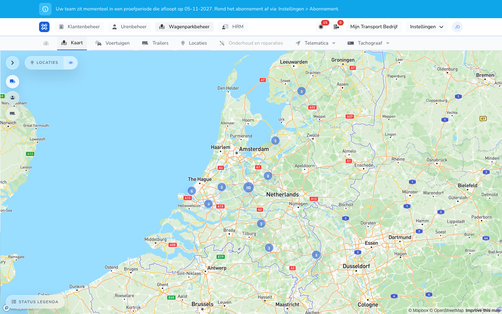

{/* translated-from: nl/management/fleet-management/map.mdx sha256:7cd3c9d8f22d2db317a31739d488e8cd05ff7d3da4916dd7ecd277209caf136c */}

## Pentru ce este această pagină

Această pagină vă ajută să vizualizați vehiculele pe o hartă și într-o listă. Astfel vedeți mai repede ce vehicul căutați.

## Ce puteți face aici

- Recunoașteți vehiculele după nume și număr de înmatriculare.
- Stabiliți, din vizualizarea pe hartă, ce vehicul doriți să deschideți mai departe.

## Captură de ecran

## Ce vedeți pe pagină

- O secțiune cu hartă cu marcaje pentru vehicule.
- O listă cu numele vehiculelor și numerele de înmatriculare, lângă hartă sau sub ea.

## Cum folosiți această pagină

1. Deschideți pagina **Hartă**.
2. Căutați în listă vehiculul de care aveți nevoie.
3. Folosiți harta pentru a evalua poziția sau distribuția vehiculelor.
4. Mergeți apoi la **Vehicule** dacă doriți să modificați datele.

## Ce se întâmplă după aceea

- Vă faceți mai repede o imagine despre ce vehicul se află unde sau îi aparține.
- Puteți merge apoi mai țintit la ecranul corect al vehiculului.

## Important de știut

- Această pagină este destinată mai ales prezentării generale și recunoașterii.
- Pentru modificări ale datelor vehiculului folosiți secțiunea de vehicule.

## Pagini conexe

- Prezentarea generală a vehiculelor
- Prezentarea generală a locațiilor

