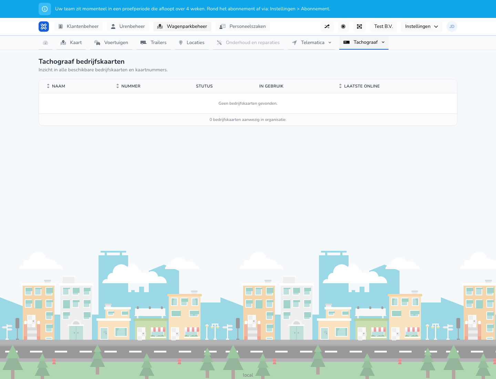

{/* translated-from: nl/management/fleet-management/tachograph/company-cards.mdx sha256:dd4c7035f0c017cdbf973b477f3d4685be97f592cc20e04f0eaa8f2f7d9182ed */}

## Pentru ce este această pagină

Aici vedeți ce carduri de întreprindere sunt disponibile și dacă sunt folosite.

## Ce puteți face aici

- Verificați cardurile de întreprindere.
- Vizualizați numerele cardurilor și starea.

## Captură de ecran

## Ce vedeți pe pagină

- Un tabel cu nume, număr, stare, în uz și ultima conectare.

## Cum folosiți această pagină

1. Deschideți **Carduri de întreprindere pentru tahograf**.
2. Verificați ce carduri sunt disponibile.
3. Folosiți starea și ultima conectare pentru a evalua dacă un card este încă folosit activ.

## Ce se întâmplă după aceea

- Aveți rapid o imagine asupra stocului de carduri și a stării cardurilor.

## Important de știut

- Folosiți acest ecran mai ales pentru prezentare generală și verificare.

## Pagini conexe

- Vehicule cu tahograf
- Șoferi cu card de conducător auto

