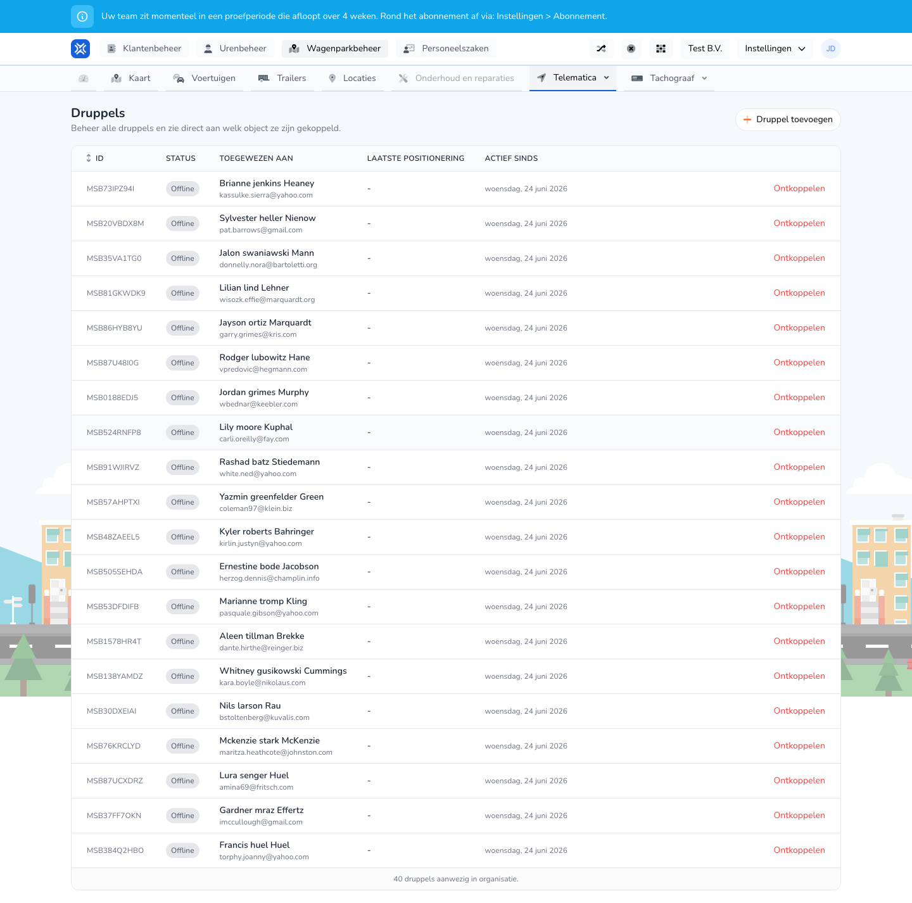

{/* translated-from: nl/management/fleet-management/telematics/beacons/overview.mdx sha256:4f366e4b6e5a6d78326b3d97ec01fa3524a40979aa74b911d82a8a3fa4a5109d */}

## Pentru ce este această pagină

Aici vedeți toate beaconurile, starea lor și cu ce obiect sunt asociate.

## Ce puteți face aici

- Vizualizați beaconurile.
- Adăugați un beacon.
- Verificați dacă un beacon este deja asociat.

## Captură de ecran

## Ce vedeți pe pagină

- Butonul **Adăugați beacon**.
- Un tabel cu ID, stare, atribuit lui, ultima poziționare și activ din.

## Cum folosiți această pagină

1. Deschideți **Beaconuri**.
2. Căutați beaconul potrivit în tabel.
3. Verificați dacă beaconul este deja asociat.
4. Adăugați un beacon nou dacă încă lipsește.

## Ce se întâmplă după aceea

- Vedeți ce beaconuri mai necesită atenție.

## Important de știut

- Beaconurile neasociate sau offline se observă imediat aici.

## Pagini conexe

- Adăugarea unui beacon
- Asocierea unui beacon

