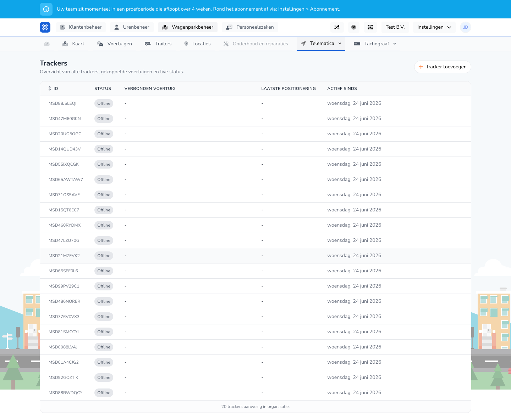

{/* translated-from: nl/management/fleet-management/telematics/trackers/overview.mdx sha256:54b7030ce8c89a4e455e01dff1272d4460b484fad4d0f46dfe65eac12c6f3350 */}

## Pentru ce este această pagină

Aici vedeți toate trackerele, starea lor și cu ce vehicul sunt asociate.

## Ce puteți face aici

- Vizualizați trackerele.
- Adăugați un tracker.
- Verificați informațiile despre stare.

## Captură de ecran

## Ce vedeți pe pagină

- Butonul **Adăugați tracker**.
- Un tabel cu ID, stare, vehicul conectat, ultima poziționare și activ din.

## Cum folosiți această pagină

1. Deschideți **Trackere**.
2. Verificați starea trackerelor.
3. Folosiți **Adăugați tracker** dacă un tracker nou încă lipsește.

## Ce se întâmplă după aceea

- Știți ce trackere sunt active și pe ce vehicul sunt montate.

## Important de știut

- Fiți atenți mai ales la stările offline și la asocierile lipsă cu vehicule.
- Folosiți această prezentare generală pentru a recunoaște rapid semnalele tehnice.

## Pagini conexe

- Adăugarea unui tracker
- Prezentarea generală a telematicii

