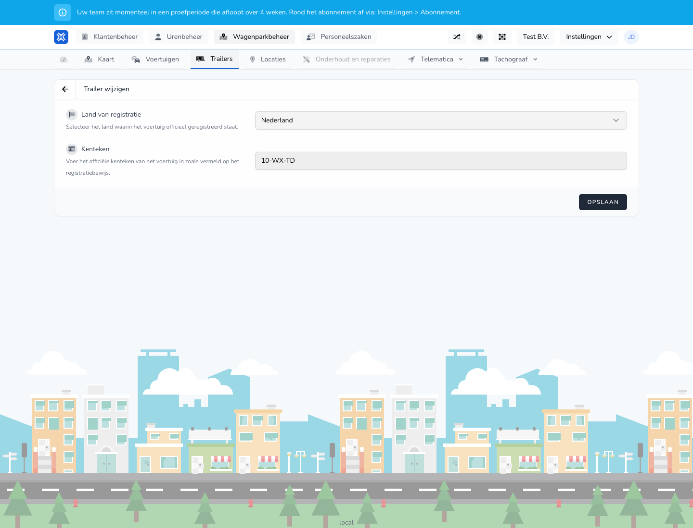

{/* translated-from: nl/management/fleet-management/trailers/edit.mdx sha256:20f39744a5af8330364b9d73f16dc90cd43c2cd7533c4fb9f7f2a961002327ad */}

## Pentru ce este această pagină

Pe această pagină modificați datele unei remorci existente.

## Ce puteți face aici

- Modificați datele de înmatriculare.
- Verificați și salvați datele remorcii.

## Captură de ecran

## Ce vedeți pe pagină

- Ecranul **Modificați remorca**.
- Datele deja completate ale remorcii, precum țara și numărul de înmatriculare.
- Un formular care seamănă cu pagina de creare.

## Cum folosiți această pagină

1. Deschideți remorca din prezentarea generală.
2. Modificați datele care s-au schimbat.
3. Verificați încă o dată valorile completate.
4. Salvați modificarea.

## Ce se întâmplă după aceea

- Informațiile modificate ale remorcii sunt folosite imediat în prezentarea generală și în procesele asociate.

## Important de știut

- Modificați doar datele care s-au schimbat cu adevărat.
- Verificați la final dacă remorca rămâne corect recunoscută în prezentarea generală.

## Pagini conexe

- Prezentarea generală a remorcilor
- Crearea unei remorci

