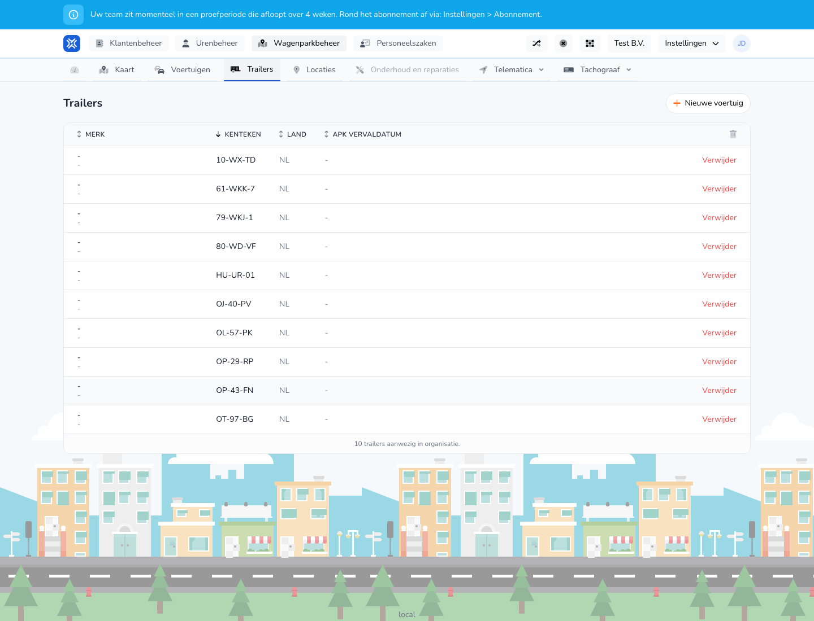

{/* translated-from: nl/management/fleet-management/trailers/overview.mdx sha256:ce82b614f18ebe1bd1aeb1ee77966fa4d51f68900fc4d6bd9b852e88794c8574 */}

## Pentru ce este această pagină

Aici gestionați toate remorcile. Vedeți imediat ce remorci sunt cunoscute și ce acțiuni sunt disponibile.

## Ce puteți face aici

- Vizualizați remorcile.
- Adăugați o remorcă.
- Ștergeți o remorcă.

## Captură de ecran

## Ce vedeți pe pagină

- Butonul **Vehicul nou** pentru introducerea unei remorci noi.
- Un tabel cu număr de înmatriculare, țară și data expirării inspecției tehnice.
- Acțiuni pentru fiecare rând de remorcă.

## Cum folosiți această pagină

1. Deschideți **Remorci** în Gestionarea flotei.
2. Căutați remorca potrivită în tabel.
3. Deschideți pagina de creare dacă doriți să introduceți o remorcă nouă.
4. Folosiți acțiunile disponibile pe fiecare rând pentru urmărirea ulterioară.

## Ce se întâmplă după aceea

- Remorcile noi apar în prezentarea generală.
- Remorcile șterse dispar din lista activă.

## Important de știut

- Fiți atenți mai ales la numărul de înmatriculare și la data expirării.
- În această prezentare generală vedeți rapid dacă datele remorcilor sunt încă complete.

## Pagini conexe

- Crearea unei remorci
- Modificarea unei remorci

