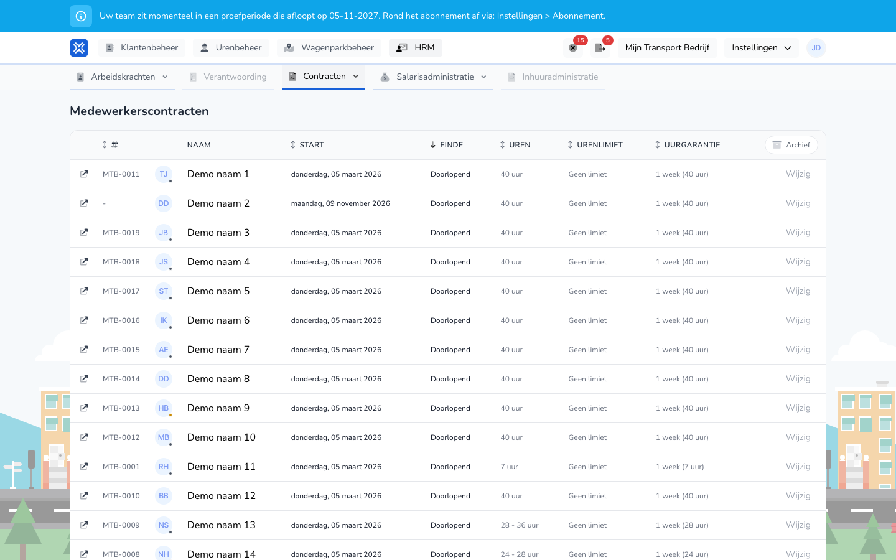

{/* translated-from: nl/management/human-resources/contracts/overview.mdx sha256:56285641d8cc2e64213c9de70f5584ae22d78f321cf8da8034742315ec0e704e */}

import { Hint } from '/snippets/hint.jsx';

## Pentru ce este această pagină

La **Contracte** vedeți laolaltă contractele tuturor lucrătorilor dumneavoastră, pe tip de angajare: angajați cu contract de muncă, PFA (ZZP) și charter.

## Captură de ecran

## Cine o poate folosi

- Un administrator al organizației.

## Cum folosiți această pagină

1. Deschideți **Resurse umane** și alegeți **Contracte**.
2. Alegeți în meniu, sub **Contracte**, lista: **Contracte de muncă**, **Contracte PFA (ZZP)** sau **Contracte charter**.
3. Faceți clic pe **Arhivă** pentru a vedea contractele care s-au încheiat deja.
4. Faceți clic pe **Editați** la un contract pentru a modifica contractul acelui lucrător. Consultați [Modificarea unui lucrător](/ro/management/human-resources/workers/edit).

## Câmpuri

| Coloană | Semnificație |
|-------|-----------|
| **Nume** | Lucrătorul, cu număr de personal și adresă de e-mail. Faceți clic pe nume pentru a deschide lucrătorul. |
| **Început** | Data la care începe contractul. |
| **Sfârșit** | Data la care se încheie contractul sau `Doorlopend`. |
| **Ore** | Doar la contractele de muncă: orele contractuale. |
| **Plafon anual de ore** | Doar la contractele de muncă: numărul maxim de ore sau `Geen limiet`. |
| `Uurgarantie` | Doar la contractele de muncă: pentru câte săptămâni este garantat salariul, cu numărul de ore. |

## Ce se întâmplă după aceea

- După **Editați** ajungeți în fila **Contracte** a lucrătorului. Acolo creați un contract, îl modificați sau setați o dată de încheiere.

## Limitări

- Pe această pagină nu creați și nu încheiați un contract. Aceasta o faceți la lucrătorul însuși. Consultați [Crearea unui lucrător](/ro/management/human-resources/workers/create).
- Fără **Arhivă** vedeți doar contractele care încă sunt în desfășurare sau care se încheie astăzi ori mai târziu.
- Vedeți doar lucrătorii cu o licență activă. <Hint kind="grey">Coloanele **Ore**, **Plafon anual de ore** și `Uurgarantie` le vedeți dacă organizația dumneavoastră folosește modulul pentru procesarea salariilor.</Hint>
