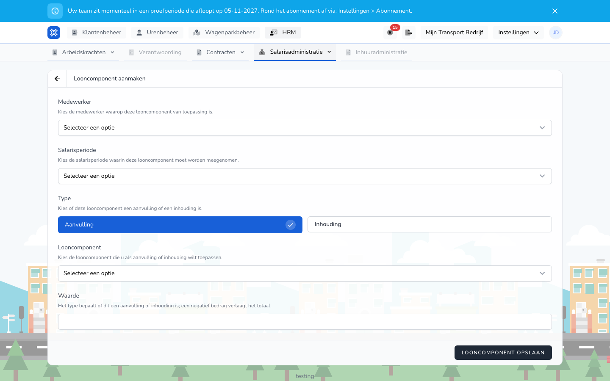

{/* translated-from: nl/management/human-resources/payroll-components/create.mdx sha256:5e418ad2b4c0319cbea47b15effdfcbbc27fac75b847c52556595b23e6faa3de */}

import { Hint } from '/snippets/hint.jsx';

## Pentru ce este această pagină

Aici adăugați, pentru un angajat și o perioadă de salarizare, o sumă la salariu sau scădeți o sumă din acesta.

## Captură de ecran

## Cine o poate folosi

- Un administrator cu drepturi depline în organizație.
- Organizația are nevoie de modulul **Variabile de salarizare**.

## Cum folosiți această pagină

1. Deschideți **Resurse umane** → **Administrare salarii** → **Adaosuri și rețineri**.
2. Faceți clic pe **Element salarial nou**.
3. Alegeți **Angajat**.
4. Alegeți **Perioadă de salarizare**.
5. Alegeți la **Tip** dacă este un **Adaos** sau o **Reținere**.
6. Alegeți **Element salarial**.
7. Completați **Valoare**.
8. Faceți clic pe **Salvați elementul salarial**.

## Câmpuri

Toate câmpurile sunt obligatorii.

| Câmp | Ce completați |
|------|--------------|
| **Angajat** | Angajatul care primește sau cedează suma. |
| **Perioadă de salarizare** | Perioada în care se contabilizează suma, de exemplu `Periode 2026-11`. Alegeți din perioada curentă și din perioadele pentru care există deja o rulare de salarizare. |
| **Tip** | **Adaos** adaugă suma, **Reținere** o scade. **Adaos** este preselectat. |
| **Element salarial** | Tipul de sumă, de exemplu **Indemnizație kilometrică** sau **Avans** la un adaos și **Amenzi** la o reținere. <Hint kind="yellow">Ce elemente salariale vedeți depinde de tip și de setările organizației dumneavoastră.</Hint> |
| **Valoare** | Suma în euro, cu două zecimale. <Hint kind="grey">O sumă negativă reduce totalul.</Hint> |

## Ce se întâmplă după aceea

- Reveniți în prezentarea generală, unde apare noul element salarial.
- Rularea de salarizare a acelei perioade preia suma. Consultați [Adaosuri și rețineri](/ro/management/human-resources/payroll-components/overview) pentru ce se întâmplă cu rularea.

## Limitări

- Un element salarial este valabil pentru un angajat și o perioadă. Pentru o sumă fixă în fiecare perioadă creați un element salarial pe perioadă.
- Dacă lăsați gol un câmp obligatoriu, elementul salarial nu este salvat și vedeți un mesaj la acel câmp.
