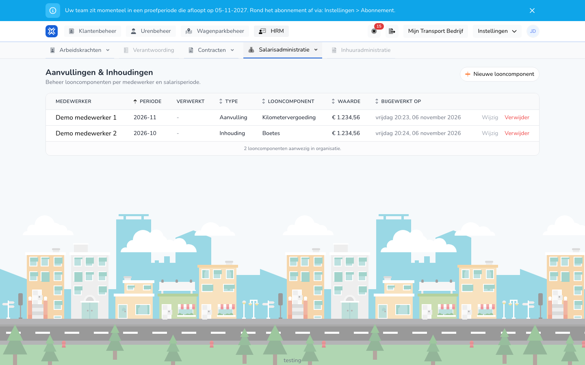

{/* translated-from: nl/management/human-resources/payroll-components/overview.mdx sha256:df5f92848b99f94f979811bd40269c1fca2471937be026975560b1967afc0b31 */}

import { Hint } from '/snippets/hint.jsx';

## Pentru ce este această pagină

Aici gestionați sume pe care, separat de ore, le adăugați la salariu sau le scădeți din acesta, precum o indemnizație kilometrică, un avans sau o amendă. O astfel de sumă se numește element salarial.

## Captură de ecran

## Cine o poate folosi

- Un administrator cu drepturi depline în organizație.
- Organizația are nevoie de modulul **Variabile de salarizare**.

## Cum folosiți această pagină

1. Deschideți **Resurse umane** și alegeți **Administrare salarii**.
2. Faceți clic pe **Adaosuri și rețineri**.
3. Vedeți pe fiecare rând angajatul, perioada și suma.
4. Faceți clic pe **Element salarial nou** pentru a adăuga o sumă. Consultați [Crearea unui element salarial](/ro/management/human-resources/payroll-components/create).
5. Faceți clic pe **Editați** sau **Ștergeți** pe rândul unui element salarial. Consultați [Modificarea unui element salarial](/ro/management/human-resources/payroll-components/edit).

## Câmpuri

| Coloană | Semnificație |
|-------|-----------|
| **Angajat** | Angajatul care primește sau cedează suma. |
| **Perioadă** | Perioada de salarizare, de exemplu 2026-10. |
| **Procesat** | Starea rulării de salarizare care a plătit suma. O liniuță înseamnă că acest lucru nu s-a întâmplat încă. |
| **Tip** | **Adaos** sau **Reținere**. |
| **Element salarial** | Tipul de sumă, precum **Indemnizație kilometrică** sau **Amenzi**. |
| **Valoare** | Suma. |
| **Actualizat la** | Când a fost salvat ultima dată elementul salarial. |

## Ce se întâmplă după aceea

- Un element salarial se contabilizează în rularea de salarizare a perioadei sale. Dacă acea rulare este o ciornă sau este blocată, este imediat recalculată. <Hint kind="grey">Nu trebuie să mai executați singur rularea din nou pentru aceasta.</Hint>
- Dacă acea rulare a fost deja procesată, primește starea **Corectat**. Suma merge atunci cu o corecție. Consultați [Corecții la o rulare de salarizare](/ro/management/human-resources/payroll-runs/corrections).

## Limitări

- Prezentarea generală nu are filtre și nici câmp de căutare.
- **Ștergeți** cere confirmare și apoi elimină imediat elementul salarial. <Hint kind="red">Un element salarial șters nu poate fi recuperat. Dacă aparține unei rulări procesate, rularea este verificată din nou pentru corecții.</Hint>
