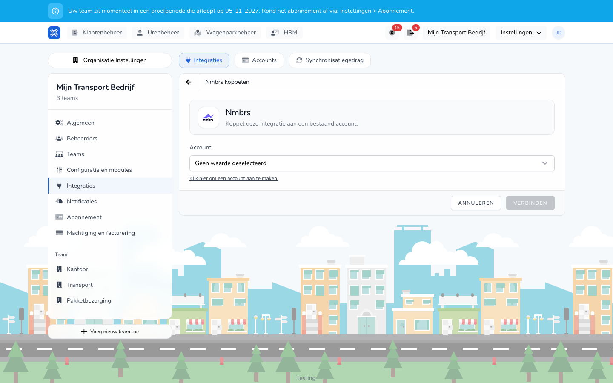

{/* translated-from: nl/management/human-resources/payroll-integrations/nmbrs.mdx sha256:7a8a42a026df04516a531f2e502d6ba211349696a8050f78b22b445203d90354 */}

import { Hint } from '/snippets/hint.jsx';

## Pentru ce este această pagină

Cu integrarea Nmbrs trimiteți rulări de salarizare procesate către Nmbrs și preluați din Nmbrs angajați, contracte și concedii.

## Captură de ecran

## Cine o poate folosi

- Un administrator sau un manager al organizației, cu un cont Nmbrs care are acces la angajator.
- Organizația are nevoie de modulul **Variabile de salarizare**.

## Cum folosiți această pagină

1. Creați un cont pentru **Nmbrs** și autentificați-vă la Nmbrs. Consultați [Conturi](/ro/settings/organization/integrations/accounts).
2. Deschideți **Integrări**, faceți clic pe **Adăugați o integrare** și faceți clic la **Nmbrs** pe **Conectare**.
3. Alegeți **Cont**.
4. Alegeți **Angajator** din lista Nmbrs.
5. Dați integrării un **Nume** și faceți clic pe **Conectare**.
6. Completați setările și faceți clic pe **Salvați setările**.
7. La **Comportamentul sincronizării**, activați comutatorul de la **Trimitere rulări de salarizare** și salvați.

## Câmpuri

| Câmp | Ce completați |
|------|--------------|
| **Angajator** (obligatoriu) | Firma din Nmbrs. Un angajator care este deja asociat nu poate fi ales încă o dată. |
| **Creați automat angajați** | Dacă este dezactivat, TransportKlok asociază doar angajații cu același număr de personal și același nume de familie. |
| **Asocieri ale codurilor de salarizare** | Ce cod salarial din Nmbrs corespunde cărui tip de ore și cărei indemnizații. <Hint kind="yellow">Aceasta depinde de configurarea firmei dumneavoastră din Nmbrs. Stabiliți codurile cu cine se ocupă de administrarea dumneavoastră salarială.</Hint> |
| **Angajații Nmbrs pentru importul salarial** | Angajații Nmbrs care participă, separați prin virgule sau rânduri. Dacă lăsați gol, participă toți angajații asociați. |
| **Asocieri ale grupurilor de concediu Nmbrs** | Ce grup de concediu din Nmbrs corespunde cărui tip de concediu. |

## Ce se întâmplă după aceea

- La **Trimitere** a unei rulări de salarizare, TransportKlok introduce în Nmbrs, pentru fiecare angajat, orele și elementele salariale ale acelei perioade și adaugă extrasul salarial ca pdf. Corecțiile preluate merg împreună.
- Datele pe care TransportKlok le-a introdus anterior în Nmbrs pentru acea perioadă sunt actualizate sau eliminate, astfel încât Nmbrs să aibă ultima versiune procesată.
- În fiecare noapte, TransportKlok preia din Nmbrs angajați, contracte și concedii.
- La **Comportamentul sincronizării** → **Execuții** vedeți, pentru fiecare trimitere, dacă este **Reușit** sau **Eșuat**.

## Limitări

- Firma din Nmbrs trebuie să lucreze cu perioade lunare. <Hint kind="yellow">Aceasta depinde de configurarea firmei dumneavoastră din Nmbrs.</Hint>
- Angajații care nu sunt asociați cu angajatorul ales din Nmbrs sunt omiși de trimitere.
- O trimitere eșuează, printre altele, dacă accesul la Nmbrs a expirat, dacă nu este ales niciun angajator, dacă un element salarial nu are cod Nmbrs sau dacă acea perioadă conține deja în Nmbrs date ale unei alte rulări sau integrări.
