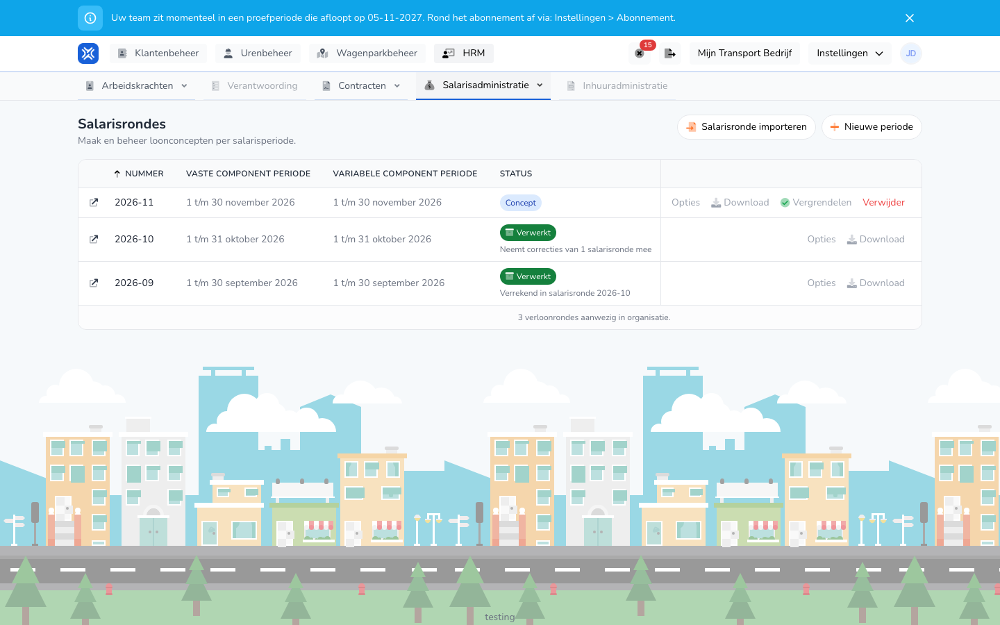

{/* translated-from: nl/management/human-resources/payroll-runs/overview.mdx sha256:05ac2c05a7be3b86b8cd95b8d5d4be04086c5a41eb5ebf7394d77dc2f02203b9 */}

## Pentru ce este această pagină

Aici vedeți toate rulările de salarizare ale organizației dumneavoastră, cu perioada de salarizare și starea fiecărei rulări. Din această prezentare generală creați o rulare nouă, procesați o rulare și descărcați exporturile.

## Captură de ecran

## Cine o poate folosi

- Un administrator cu drepturi depline în organizație.
- Organizația are nevoie de modulul **Variabile de salarizare**. Fără acest modul, **Rulări de salarizare** nu apare în meniu.

## Cum folosiți această pagină

1. Deschideți **Resurse umane** și alegeți **Administrare salarii**.
2. Faceți clic pe **Rulări de salarizare**.
3. Căutați rularea în prezentarea generală. Cea mai nouă rulare este în partea de sus.
4. Folosiți butoanele de pe rândul rulării. **Opțiuni** și **Descărcați** deschid o listă de alegere.
5. Faceți clic pe pictograma din fața numărului pentru a deschide detaliile rulării.
6. Faceți clic pe **Perioadă nouă** pentru a crea o rulare. Consultați [Crearea unei rulări de salarizare](/ro/management/human-resources/payroll-runs/create).

## Câmpuri

Prezentarea generală nu are filtre. Fiecare rând afișează:

| Coloană | Semnificație |
|-------|-----------|
| **Număr** | Numărul rulării, de exemplu 2026-10. |
| **Perioada elementelor fixe** | Perioada elementelor salariale fixe. |
| **Perioada elementelor variabile** | Perioada elementelor salariale variabile. |
| **Stare** | La ce etapă se află rularea, vezi mai jos. |
| **Ultima execuție la** | Când a fost calculată rularea ultima dată. |

O rulare are una dintre aceste stări:

| Stare | Semnificație |
|--------|-----------|
| **Ciornă** | Rularea a fost calculată și mai poate fi modificată. |
| **În curs** | O sarcină este în desfășurare, precum un calcul sau o analiză. Procentul avansează. |
| **Blocat** | Rularea este blocată și gata de finalizat. |
| **Procesat** | Rularea a fost procesată. |
| **Corectat** | După procesare s-a găsit o diferență. Consultați [Corecții](/ro/management/human-resources/payroll-runs/corrections). |
| **Eșuat** | Sarcina nu a reușit. |

Sub stare poate apărea și:

- `Neemt correcties van 1 salarisronde mee`: această rulare a preluat corecția unei rulări mai vechi.
- `Verrekend in salarisronde` cu un număr: corecția acestei rulări a fost plătită în acea rulare mai nouă. Textul este un link către acea rulare.

Butoanele de pe un rând depind de stare:

| Buton | Când |
|------|---------|
| **Opțiuni** → **Executați din nou** | La o ciornă. |
| **Opțiuni** → **Deblocați** | La o rulare blocată. |
| **Opțiuni** → **Analizați corecțiile** | La o rulare procesată sau corectată. |
| **Blocați** | La o ciornă. |
| **Finalizați** | La o rulare blocată sau corectată. Consultați [Procesarea unei rulări de salarizare](/ro/management/human-resources/payroll-runs/process). |
| **Descărcați** | Afișează exporturile care sunt gata pentru rulare. Consultați [Exporturile unei rulări de salarizare](/ro/management/human-resources/payroll-runs/exports). |
| **Ștergeți** | La o ciornă sau la o rulare blocată. |

## Ce se întâmplă după aceea

- Prezentarea generală se reîmprospătează singură cât timp o sarcină este în desfășurare.
- **Blocați** cere mai întâi confirmare în fereastra **Blochează rularea de salarizare**. Apoi rularea este recalculată și primește starea **Blocat**.
- **Ștergeți** cere mai întâi confirmare în fereastra **Ștergeți rularea de salarizare**.

## Limitări

- O rulare blocată nu o puteți șterge. Deblocați mai întâi rularea cu **Opțiuni** → **Deblocați**.
- O rulare procesată sau corectată nu o puteți șterge.
- Cât timp o sarcină a unei rulări este în desfășurare, așteptați până când este gata înainte de a porni o acțiune nouă pe acea rulare.
- Cu **Importați rularea de salarizare** puneți ca rezultat într-o rulare un export al variabilelor de salarizare (.xlsx) creat anterior. Orele nu sunt atunci recalculate.
