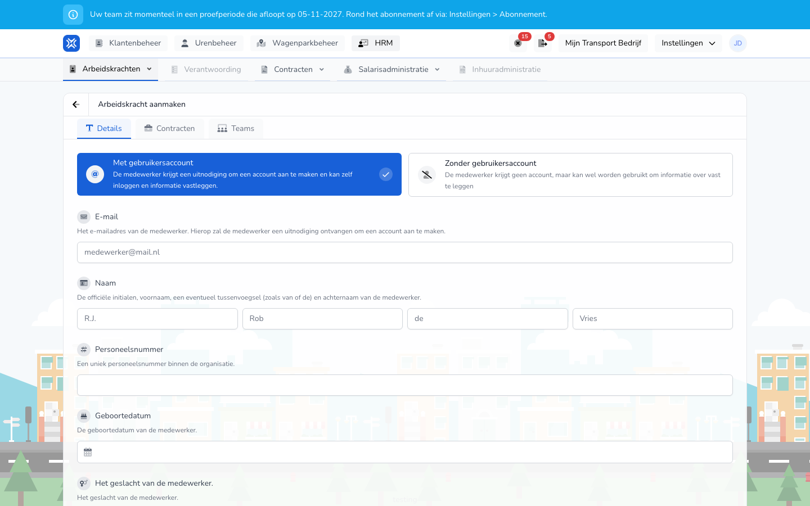

{/* translated-from: nl/management/human-resources/workers/create.mdx sha256:8d78ca5888212ea402f49b6fb16792721a6700ec7648e46cc3d536af1b3b6521 */}

import { Hint } from '/snippets/hint.jsx';

## Pentru ce este această pagină

Aici adăugați un lucrător: persoana, contractul și echipele din care face parte lucrătorul.

## Captură de ecran

## Cine o poate folosi

- Un administrator sau un manager al organizației.

## Cum folosiți această pagină

1. Deschideți **Resurse umane** → **Lucrători** și faceți clic pe **Creați lucrător**.
2. În fila **Detalii** alegeți dacă lucrătorul primește un cont: `Met gebruikersaccount` sau `Zonder gebruikersaccount`.
3. Completați datele persoanei.
4. Deschideți fila **Contracte**, faceți clic pe `+` și completați contractul.
5. Deschideți fila **Echipe** și bifați echipele.
6. Faceți clic pe **Creați lucrător**.

## Câmpuri

Fila **Detalii**:

| Câmp | Ce completați |
|------|--------------|
| `Met gebruikersaccount` / `Zonder gebruikersaccount` (obligatoriu) | Cu un cont, lucrătorul se poate autentifica singur și poate înregistra date. Fără cont, înregistrați doar date despre lucrător. |
| **E-mail** | Doar cu un cont, și atunci obligatoriu. La această adresă primește lucrătorul invitația. |
| **Nume** (obligatoriu) | Inițiale, prenume, eventual prefix și nume de familie. Prefixul nu este obligatoriu. |
| **Număr de angajat** | Un număr unic în organizația dumneavoastră. |
| **Data nașterii** | Data nașterii. |
| Gen | **Bărbat**, **Femeie** sau **Altele**. |
| **Codul de conducător auto din tahograf** | Codul cardului de conducător auto al șoferului. <Hint kind="grey">Vedeți acest câmp, **Adresa de domiciliu** și **Locații** dacă telematica este activată pentru organizația dumneavoastră.</Hint> |
| **Adresa de domiciliu** | Adresa de domiciliu. |
| **Locații** | Pe tip de locație, precum `Standplaatsen` și `Kantoren`, ce locații sunt valabile pentru acest lucrător. |

Fila **Contracte**, pentru fiecare contract:

| Câmp | Ce completați |
|------|--------------|
| **Tip de angajare** (obligatoriu) | **Angajat**, **PFA (ZZP)** sau **Charter**. |
| **Început** (obligatoriu) | Data la care începe contractul. |
| **Sfârșit** | Data la care se încheie contractul. Gol înseamnă pe durată nedeterminată. |
| **Tipul contractului** | La un angajat: **Lucrător la cerere**, **Angajat cu normă parțială** sau **Angajat cu normă întreagă**. |
| **Tipul orelor contractuale** | **Ore fixe** sau **Ore min-max**. |
| **Ore contractuale** | Numărul de ore pe săptămână. <Hint kind="yellow">Un angajat cu normă întreagă are întotdeauna 40 de ore, un lucrător la cerere 0. Ce înseamnă orele pentru calculul salariului depinde de contractul colectiv (CAO) sau de setarea contractului.</Hint> |

Fila **Echipe**: bifați echipele. Cu **Selectați toate** alegeți toate echipele. Alegeți din echipele pe care le gestionați și cel puțin una.

## Ce se întâmplă după aceea

- Reveniți în prezentarea generală cu noul lucrător.
- Cu un cont, lucrătorul primește un e-mail cu **Acceptați invitația**. Cât timp aceasta nu este acceptată, invitația se află la [Invitații](/ro/management/human-resources/workers/invitations).

## Limitări

- Un lucrător are nevoie de cel puțin un contract. Contractele nu au voie să se suprapună.
- O adresă de e-mail care are deja o invitație deschisă sau aparține deja organizației dumneavoastră nu o puteți folosi încă o dată.
