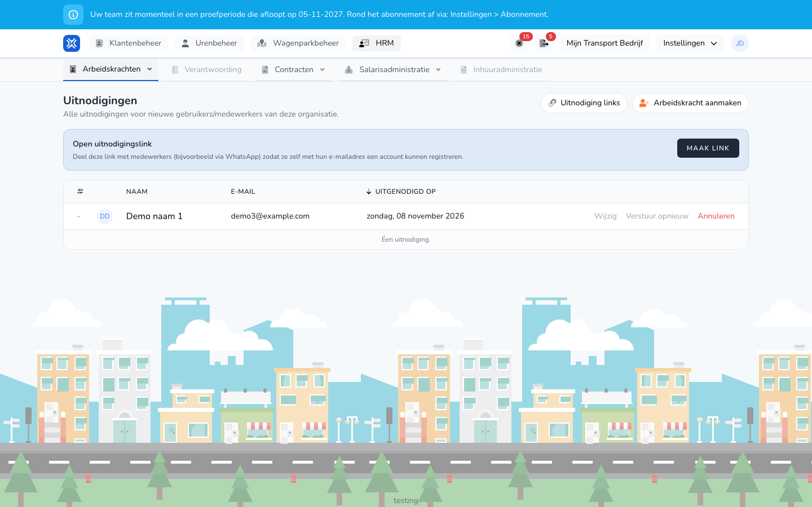

{/* translated-from: nl/management/human-resources/workers/invitations.mdx sha256:8560644f52ce4ae6d97becb6b8bea22bc0cc2497c2921d3d484a1a442040a208 */}

import { Hint } from '/snippets/hint.jsx';

## Pentru ce este această pagină

Aici vedeți cine a primit o invitație și încă nu a acceptat-o. Retrimiteți o invitație, o retrageți sau creați un link cu care oamenii își creează singuri un cont.

## Captură de ecran

## Cine o poate folosi

- Un administrator sau un manager al organizației.

## Cum folosiți această pagină

Trimiterea unei invitații:

1. Creați un lucrător cu `Met gebruikersaccount` și un **E-mail**. Consultați [Crearea unui lucrător](/ro/management/human-resources/workers/create).
2. Invitația merge imediat la acea adresă de e-mail.

Invitații deschise:

1. Deschideți **Resurse umane** → **Lucrători** și faceți clic pe **Invitații**.
2. Faceți clic pe **Trimiteți din nou** pentru a trimite încă o dată e-mailul.
3. Faceți clic pe **Anulați** pentru a retrage o invitație și confirmați cu **Eliminați**.
4. Faceți clic pe **Editați** pentru a modifica lucrătorul, de exemplu o adresă de e-mail greșită.

Un link deschis de invitare:

1. La **Linkul deschis de invitare**, faceți clic pe **Creați linkul**.
2. Faceți clic pe **Copiați** și distribuiți linkul, de exemplu prin WhatsApp.
3. Oricine are linkul își creează singur un cont cu propria adresă de e-mail. <Hint kind="red">Oricine are linkul se poate înscrie în organizația dumneavoastră. Retrageți un link dacă nu-l mai folosiți.</Hint>
4. Sub **Linkuri de invitare** vedeți toate linkurile active. Cu **Copiați linkul** copiați din nou un link, cu **Revocați** îl dezactivați.

## Câmpuri

| Coloană | Semnificație |
|-------|-----------|
| **Nume** | Numele lucrătorului. |
| **E-mail** | Adresa la care a mers invitația. |
| **Invitat la** | Când a fost trimisă invitația. |

## Ce se întâmplă după aceea

- Lucrătorul primește un e-mail cu butonul **Acceptați invitația**. După acceptare, invitația dispare din listă.
- În prezentarea generală, la un lucrător cu o invitație deschisă, la **Acțiuni** apare și `Kopier uitnodiging`.

## Limitări

- Invitația poate fi acceptată doar cu un cont pe aceeași adresă de e-mail.
- O invitație retrasă nu mai funcționează. Dacă doriți totuși să invitați lucrătorul, modificați adresa de e-mail prin **Editați**.
