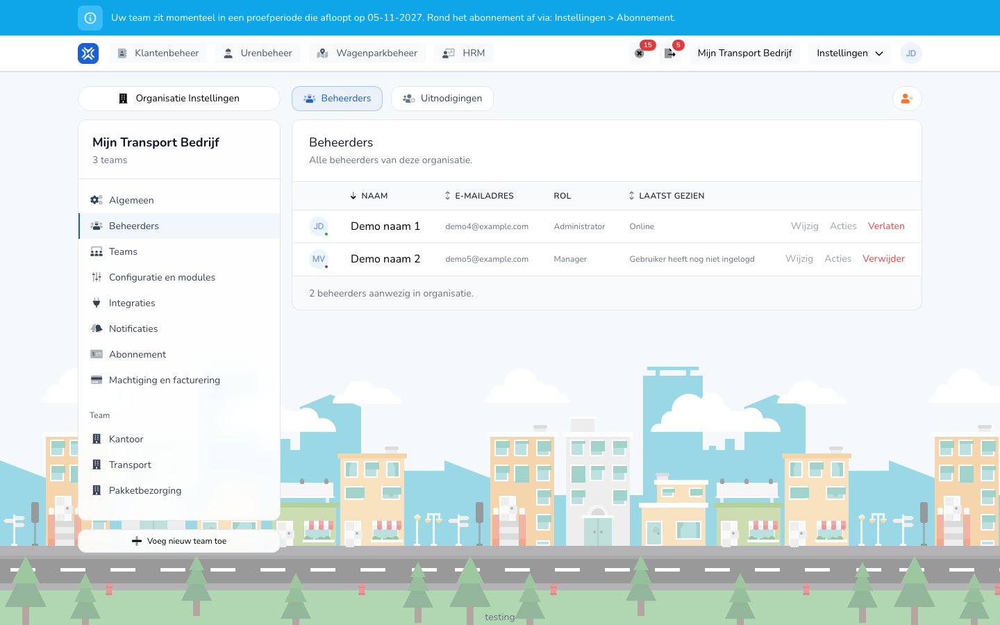

{/* translated-from: nl/settings/organization/administrators.mdx sha256:896eb6ae26f931a378b0cdf3ffa15127ae58ed53ed14ed87edfee89d7de02d59 */}

import { Hint } from '/snippets/hint.jsx';

## Pentru ce este această pagină

Aici gestionați cine conduce organizația dumneavoastră: administratorii și managerii. Angajații care doar înregistrează ore îi gestionați la [Lucrători](/ro/management/human-resources/workers/overview).

## Captură de ecran

## Cine o poate folosi

- Un administrator al organizației.

## Cum folosiți această pagină

Invitarea cuiva:

1. Deschideți **Setări** → **Setările organizației** → **Administratori**.
2. Faceți clic în dreapta sus pe butonul cu pictograma persoană-plus.
3. Completați **E-mail**, alegeți **Rol** și, dacă aveți mai multe echipe, **Echipe**.
4. Faceți clic pe **Invitați**.

Modificarea sau ștergerea cuiva:

1. În fila **Administratori**, faceți clic pe **Editați** pe rândul persoanei.
2. La **Informații** modificați **Nume complet**, sau la **Permisiuni** **Rol** și **Echipe**, și faceți clic pe **Salvați**.
3. Faceți clic pe **Ștergeți** pentru a scoate pe cineva din organizație și confirmați.

## Câmpuri

| Coloană | Semnificație |
|-------|-----------|
| **Nume** | Numele administratorului sau al managerului. |
| **Adresă de e-mail** | Adresa de e-mail cu care se autentifică persoana. |
| **Rol** | **Administrator** sau **Manager**. |
| **Văzut ultima dată** | **Online**, cât timp în urmă a fost activă persoana, sau **Utilizatorul nu s-a autentificat încă**. |

La o invitație:

| Câmp | Ce completați |
|------|--------------|
| **E-mail** (obligatoriu) | Adresa la care merge invitația. |
| **Rol** (obligatoriu) | **Administrator** sau **Manager**. |
| **Echipe** | Echipele la care are acces persoana. Cel puțin una. Vedeți acest câmp dacă organizația dumneavoastră are mai multe echipe. |

Ce are voie să facă un rol:

| Rol | Ce are voie să facă acest rol |
|-----|------------------|
| **Administrator** | Să gestioneze întreaga organizație: toate setările, administratorii, abonamentul și facturile, și tot ce are voie un manager. |
| **Manager** | Să vizualizeze, să aprobe, să respingă, să creeze și să exporte înregistrări ale timpului de lucru, pentru echipele din care face parte managerul. |

Un angajat nu primește aici un rol. Un angajat își face propriile înregistrări ale timpului de lucru și primește un cont dacă îl creați pe angajat cu un cont. Consultați [Crearea unui lucrător](/ro/management/human-resources/workers/create).

## Ce se întâmplă după aceea

- Invitația se află în fila **Invitații** până când este acceptată. Acolo o puteți **Trimiteți din nou** sau **Anulați**.
- După acceptare, persoana se află în fila **Administratori**.
- Cu **Părăsiți** pe propriul rând părăsiți singur organizația.
- Permisiunile rezultă direct din rol. Nu activați și nu dezactivați permisiuni separate pe persoană.
- Cu **Echipe** limitați un manager la anumite echipe. Dacă alegeți toate echipele, rolul este valabil pentru întreaga organizație.

## Limitări

- O organizație păstrează întotdeauna cel puțin un administrator. <Hint kind="red">Ultimul administrator nu-l puteți șterge.</Hint>
- Propriul rol și propriile echipe nu le puteți modifica singur.
- Un manager nu vede meniul **Setările organizației**.
- O adresă de e-mail care are deja o invitație sau aparține deja organizației nu o puteți invita încă o dată.
