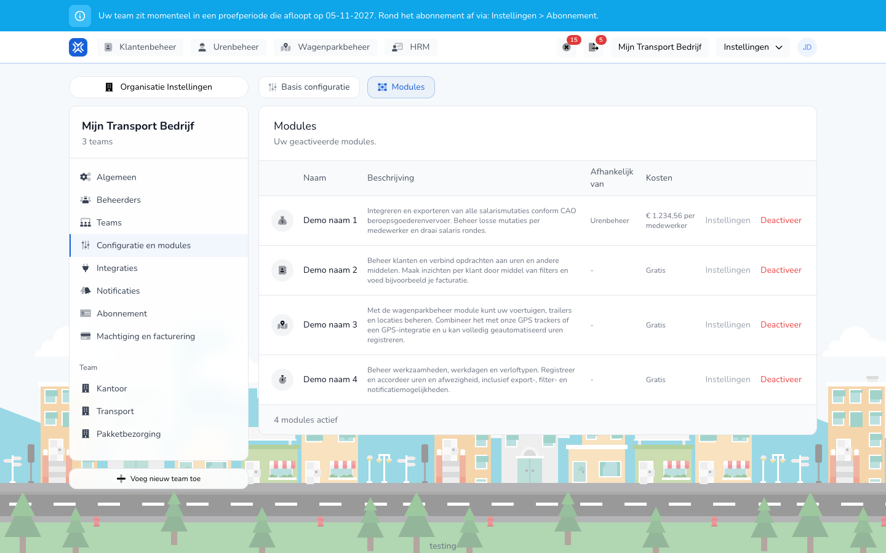

{/* translated-from: nl/settings/organization/configuration/modules.mdx sha256:af7a2d1880b349c542157d08ed9ebdc8470d02ab150f2462a43779e735b39329 */}

import { Hint } from '/snippets/hint.jsx';

## Pentru ce este această pagină

Aici activați sau dezactivați module pentru organizația dumneavoastră și setați pentru fiecare modul cum funcționează.

## Captură de ecran

## Cine o poate folosi

- Un administrator al organizației.

## Cum folosiți această pagină

1. Deschideți **Setări** → **Setările organizației** → **Configurare și module** și alegeți fila **Module**.
2. Faceți clic pe **Adăugați un modul** și alegeți **Activați** la un modul, sau faceți clic pe **Dezactivați** la un modul activ.
3. Alegeți în fereastră dacă modificarea intră în vigoare imediat sau de la următoarea perioadă de abonament.
4. La un modul, faceți clic pe **Setări** pentru a modifica setările acelui modul și faceți clic pe **Salvați**.

## Câmpuri

Modulele:

| Modul | Ce face |
|--------|--------------|
| **Gestionarea orelor** | Gestionarea activităților, a zilelor de lucru și a tipurilor de concediu, și înregistrarea și aprobarea orelor și a absențelor. |
| **Gestionarea clienților** | Gestionarea clienților și asocierea lor cu ore. |
| **Gestionarea flotei** | Gestionarea vehiculelor, a remorcilor și a locațiilor, cu trackere sau o integrare GPS. |
| **Variabile de salarizare** | Executarea rulărilor de salarizare și exportul variabilelor de salarizare. Lucrează împreună cu **Gestionarea orelor**. |

În coloana **Costuri** vedeți pentru fiecare modul dacă este **Gratuit** sau cât costă pe angajat. <Hint kind="yellow">Ce module puteți activa depinde de abonamentul dumneavoastră.</Hint>

Setări pentru fiecare modul, la **Setări**:

| Modul | Setări |
|--------|--------------|
| **Gestionarea orelor** | Dacă angajații își creează singuri înregistrări ale timpului de lucru, dacă aprobarea este omisă, înregistrările manuale și ciornele, și mărimea pasului de timp. |
| **Gestionarea clienților** | Dacă puteți crea un client în timpul înregistrării. |
| **Variabile de salarizare** | Perioada de procesare a salariilor, ziua de început, formatul exportului salarial și perioada elementelor salariale variabile. <Hint kind="yellow">Aceasta depinde de contractul colectiv (CAO) sau de setarea contractului: stabiliți aceste setări cu administrarea dumneavoastră salarială.</Hint> |

## Ce se întâmplă după aceea

- Un modul activat apare în meniu. În perioada de testare folosiți un modul gratuit.
- Dacă dezactivați un modul de la perioada următoare, vedeți până atunci „Acest modul nu va mai fi disponibil de la …". Cu **Anulați dezactivarea** sau **Anulați activarea** reveniți asupra unei modificări planificate.

## Limitări

- Un modul care are nevoie de un alt modul apare împreună cu acel modul în coloana **Depinde de**.
