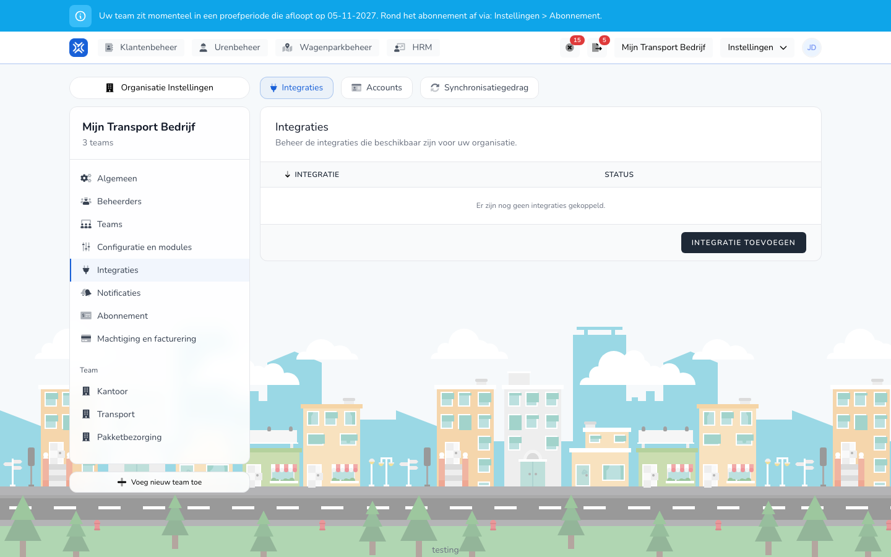

{/* translated-from: nl/settings/organization/integrations/instances.mdx sha256:8b8cba69127ca2c3727a68df43b6dcfb9cc4b01ce6206241f733fd04b1309be8 */}

import { Hint } from '/snippets/hint.jsx';

## Pentru ce este această pagină

În fila **Integrări** conectați TransportKlok la pachetul dumneavoastră de salarizare sau la sistemul dumneavoastră de telematică. O integrare folosește un cont pe care îl creați mai întâi la [Conturi](/ro/settings/organization/integrations/accounts).

## Captură de ecran

## Cine o poate folosi

- Un administrator sau un manager al organizației.
- O integrare de salarizare cere modulul **Variabile de salarizare**. O integrare GPS cere modulul **Gestionarea flotei**, cu telematica activată. <Hint kind="yellow">Dacă telematica nu este activată pentru organizația dumneavoastră, la conectare vedeți: „Telematica nu este activată pentru această organizație. Activați mai întâi telematica înainte de a crea o integrare."</Hint>
- Integrările sunt în versiune beta. <Hint kind="grey">Le vedeți doar dacă organizația dumneavoastră participă la programul beta.</Hint>

## Cum folosiți această pagină

1. Deschideți **Setări** → **Setările organizației** → **Integrări**.
2. În fila **Integrări**, faceți clic pe **Adăugați o integrare**.
3. La sistemul dumneavoastră, faceți clic pe **Conectare**.
4. Alegeți **Cont**, completați celelalte câmpuri, precum **Angajator** la Nmbrs, și dați integrării un **Nume**.
5. Faceți clic pe **Conectare**.
6. Pe pagina de setări completați ce are nevoie sistemul dumneavoastră și faceți clic pe **Salvați setările**.

## Câmpuri

| Câmp | Ce completați |
|------|--------------|
| **Cont** | Contul cu care se autentifică integrarea la sistemul dumneavoastră. |
| **Nume** | Numele din prezentarea generală, de exemplu numele societății dumneavoastră. |

Ce cere și ce face fiecare sistem se află pe pagina acelui sistem:

| Tip | Sisteme |
|-------|----------|
| Pachet de salarizare | [Nmbrs](/ro/management/human-resources/payroll-integrations/nmbrs), [Loket.nl](/ro/management/human-resources/payroll-integrations/loket), [AFAS Profit](/ro/management/human-resources/payroll-integrations/afas), [Exact Online](/ro/management/human-resources/payroll-integrations/exact-online) |
| Telematică | [Webfleet](/ro/management/fleet-management/integrations/webfleet), [Samsara](/ro/management/fleet-management/integrations/samsara), [Geotab](/ro/management/fleet-management/integrations/geotab), [FleetGo](/ro/management/fleet-management/integrations/fleetgo), [Linqo](/ro/management/fleet-management/integrations/linqo), [CO3](/ro/management/fleet-management/integrations/co3), [Verizon Connect](/ro/management/fleet-management/integrations/verizon-connect) |
| TMS | [Qargo](/ro/management/customer-management/integrations/qargo) |

## Ce se întâmplă după aceea

- Integrarea apare în prezentarea generală ca **Conectat**.
- Ce date preia sau trimite integrarea activați la [Comportamentul sincronizării](/ro/settings/organization/integrations/capabilities).
- Dacă lipsesc permisiuni sau setări, vedeți un mesaj cu **Autorizați din nou** sau **Deschideți setările**.

## Limitări

- O integrare o deconectați cu **Deconectați**. Bifați **Deconectați și contul OAuth subiacent.** pentru a șterge și contul. <Hint kind="red">O integrare deconectată nu mai preia și nu mai trimite nimic. Pentru a conecta din nou, creați din nou integrarea.</Hint>
