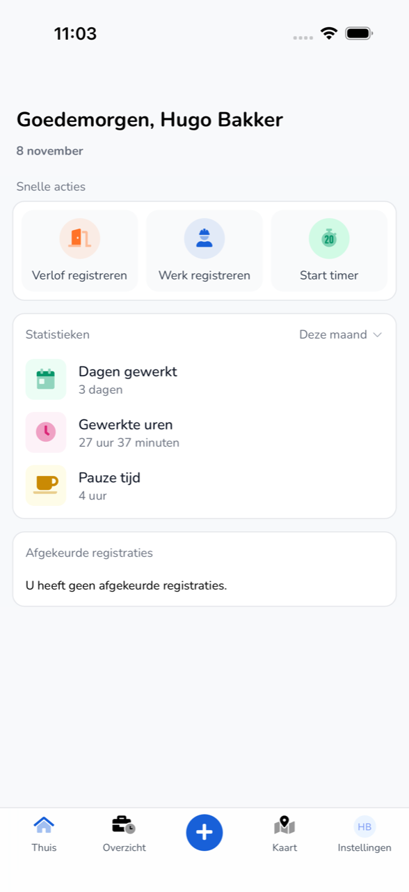

{/* translated-from: nl/workforce/app/home.mdx sha256:d3e31ca7eb3ad73d3658d65d9a53908d8f99b9935524291c537fc28361f2a3b3 */}

## Pentru ce este această pagină

**Acasă** este primul ecran după autentificare. Aici porniți o înregistrare și vedeți cât ați lucrat.

## Captură de ecran

## Cine o poate folosi

- Orice angajat care folosește aplicația.

## Cum folosiți această pagină

1. Atingeți jos **Acasă**.
2. La **Acțiuni rapide**, alegeți ce doriți să faceți:
   - **Înregistrează concediu**. Consultați [Înregistrarea concediului](/ro/workforce/app/register-leave).
   - **Înregistrează munca**. Consultați [Înregistrarea muncii](/ro/workforce/app/register-work).
   - **Pornește cronometrul**. Consultați [Cronometru](/ro/workforce/app/timer).
3. La **Statistici**, alegeți perioada, de exemplu **În această lună**.
4. La **Înregistrări respinse**, verificați dacă angajatorul dumneavoastră a respins înregistrări.

## Câmpuri

| Element | Ce vedeți |
|-----------|------------|
| **Zile lucrate** | Numărul de zile pe care le-ați lucrat în perioada aleasă. |
| **Ore lucrate** | Orele dumneavoastră lucrate în perioada aleasă. |
| **Pauza** | Pauzele dumneavoastră în perioada aleasă. |
| **Înregistrări respinse** | Înregistrările dumneavoastră care au fost respinse, sau „Nu aveți înregistrări respinse." |

Jos se află bara de meniu:

| Buton | Ce faceți acolo |
|------|-----------------|
| **Acasă** | Înapoi la acest ecran. |
| **Prezentare generală** | Înregistrările dumneavoastră pe săptămână. Consultați [Prezentare generală](/ro/workforce/app/overview). |
| `+` | Crearea unei înregistrări noi. Consultați [Înregistrarea muncii](/ro/workforce/app/register-work). |
| **Hartă** | Colegi, vehicule și remorci pe hartă. Consultați [Hartă](/ro/workforce/app/map). |
| **Setări** | Profilul, contul și securitatea dumneavoastră. Consultați [Setări](/ro/workforce/app/settings). |

## Ce se întâmplă după aceea

- O înregistrare respinsă o modificați prin [Prezentare generală](/ro/workforce/app/overview).

## Limitări

- Aici vedeți doar propriile ore și înregistrări.
- **Pornește cronometrul** îl vedeți doar dacă organizația dumneavoastră participă la programul beta.
