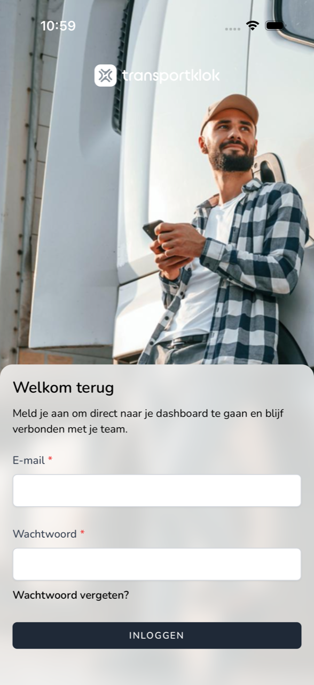
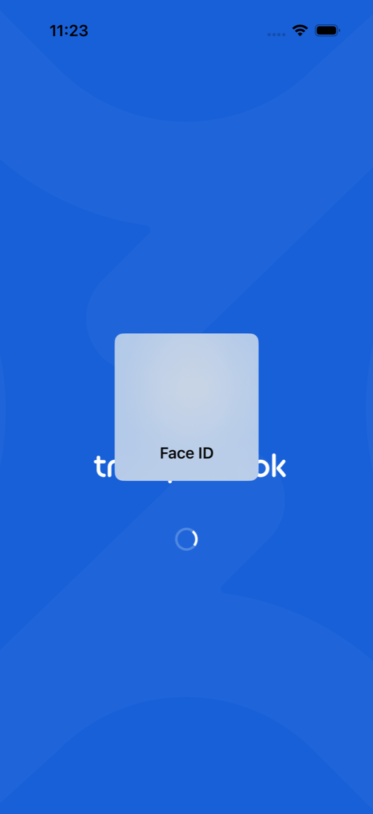

{/* translated-from: nl/workforce/app/login.mdx sha256:f872462220821e6db2e363ef810da1a8dec376bf94e20b3e450d2b0d24cd21ce */}

import { Hint } from '/snippets/hint.jsx';

## Pentru ce este această pagină

Aici citiți cum vă autentificați în aplicația TransportKlok de pe telefon și cum folosește apoi aplicația fața sau amprenta dumneavoastră.

## Captură de ecran

## Cine o poate folosi

- Orice angajat cu un cont TransportKlok. Dacă nu aveți încă un cont, acceptați mai întâi invitația angajatorului dumneavoastră. Consultați [Acceptarea invitației](/ro/sign-in/accept-invitation).

## Cum folosiți această pagină

Autentificarea:

1. Deschideți aplicația TransportKlok. Vedeți **Bine ai revenit.**
2. Completați **E-mail** și **Parolă** și atingeți **Autentificare**.
3. Dacă telefonul dumneavoastră are Face ID, Touch ID sau o amprentă configurate, telefonul le cere acum. Priviți telefonul sau puneți degetul pe senzor.
4. Dacă autentificarea în doi pași este activată, completați codul din aplicația dumneavoastră de autentificare și atingeți **Autentificare**. Dacă nu aveți aplicația la îndemână, atingeți `Use a recovery code` și completați un cod de recuperare.

Parolă uitată:

1. Atingeți **Ați uitat parola?**.
2. Completați adresa de e-mail și atingeți **Link de resetare a parolei prin e-mail**.
3. Deschideți e-mailul și setați o parolă nouă. Apoi atingeți în aplicație **Înapoi la autentificare**.

## Câmpuri

| Câmp | Ce completați |
|------|--------------|
| **E-mail** | Adresa de e-mail a contului dumneavoastră TransportKlok. |
| **Parolă** | Parola dumneavoastră. |

## Ce se întâmplă după aceea

- După autentificare, aplicația întreabă o dată dacă doriți notificări push. Consultați [Notificări push](/ro/workforce/app/push-notifications). După aceea vedeți **Acasă**. Consultați [Acasă](/ro/workforce/app/home).
- Dacă aveți Face ID sau o amprentă, aplicația le cere și când deschideți aplicația mai târziu și când sesiunea dumneavoastră este reînnoită. Nu mai trebuie atunci să completați din nou parola.

- Dacă vedeți **Autentificare mai rapidă și mai sigură**, atingeți `Gezichts-ID inschakelen` (sau numele amprentei dumneavoastră) pentru a activa aceasta, sau **Sari peste.**
- Dacă nu v-ați confirmat încă adresa de e-mail, aplicația o cere. Faceți clic pe linkul din e-mail și atingeți **Reîncarcă**, sau atingeți **Trimiteți din nou e-mailul de verificare**.

## Limitări

- După câteva încercări greșite vedeți „Prea multe încercări de autentificare. Așteptați 1 minut."
- Dacă la deschidere vedeți `Sessie niet hersteld`, atingeți `Opnieuw inloggen` și autentificați-vă cu adresa de e-mail și parola dumneavoastră.
- Dacă nu ați configurat Face ID, Touch ID sau o amprentă, vă autentificați doar cu parola. <Hint kind="grey">Dacă activați mai târziu Face ID sau o amprentă pe telefon, aplicația le folosește de la următoarea autentificare.</Hint>
