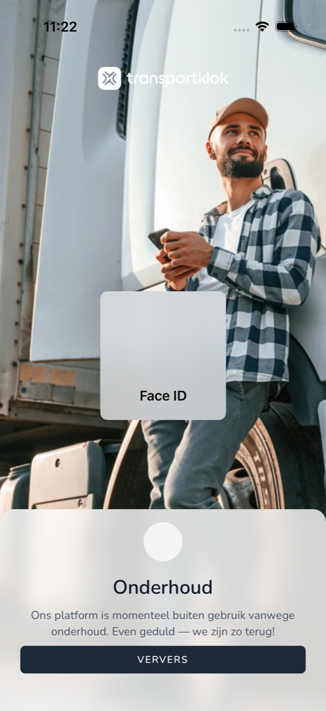

{/* translated-from: nl/workforce/app/malfunctions.mdx sha256:72b0b3d392a21fbb366c8166067b48cd4bad780ed95510d94e3dc413d8e5e742 */}

import { Hint } from '/snippets/hint.jsx';

## Pentru ce este această pagină

Uneori aplicația nu poate continua. Atunci vedeți un ecran care spune de ce. Aici citiți ce înseamnă fiecare ecran și ce faceți.

## Captură de ecran

## Cine o poate folosi

- Orice angajat care folosește aplicația.

## Cum folosiți această pagină

1. Citiți titlul ecranului.
2. Căutați acel titlu în tabelul de mai jos și faceți ce scrie acolo.

## Câmpuri

| Ecran | Ce înseamnă | Ce faceți |
|--------|------------------|------------|
| **Sunteți offline** | Telefonul dumneavoastră nu are internet. | Activați Wi-Fi sau datele mobile și atingeți **Reîncarcă**. |
| **Mentenanță** | TransportKlok este scos puțin din uz pentru mentenanță. | Așteptați puțin și atingeți **Reîncarcă**. |
| **Serviciu inaccesibil** | Aplicația nu se poate conecta la TransportKlok. | Încercați din nou în scurt timp cu **Reîncarcă**. |
| **Actualizare necesară** | Această versiune a aplicației nu mai funcționează. | Actualizați aplicația în App Store sau în Google Play. |
| **Se actualizează TransportKlok** | Aplicația descarcă și instalează o versiune nouă. | Lăsați aplicația deschisă până se termină. |
| `Sessie niet hersteld` | Aplicația nu v-a putut autentifica din nou automat. | Atingeți `Opnieuw inloggen`. |

## Ce se întâmplă după aceea

- Când funcționează din nou, aplicația continuă de unde ați rămas.

## Limitări

- Cât timp vedeți unul dintre aceste ecrane, nu puteți înregistra nimic. <Hint kind="yellow">Dacă **Mentenanță** sau **Serviciu inaccesibil** durează mult, notați-vă orele și înregistrați-le mai târziu.</Hint>
