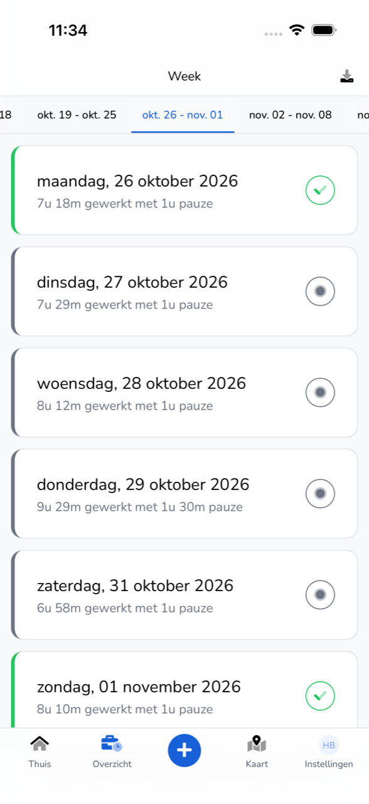
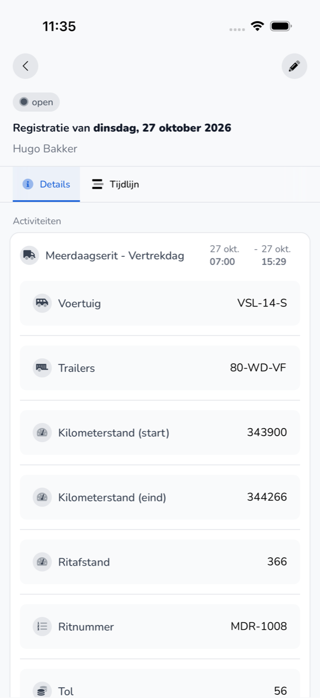

{/* translated-from: nl/workforce/app/overview.mdx sha256:cd32ebb743bdf09617ea72c35984c933fa3010a16f59fc7d0ac65fcc2799f798 */}

import { Hint } from '/snippets/hint.jsx';

## Pentru ce este această pagină

În **Prezentare generală** vedeți înregistrările dumneavoastră pe săptămână. Aici deschideți o înregistrare și modificați una care este încă deschisă.

## Captură de ecran

## Cine o poate folosi

- Orice angajat care folosește aplicația, pentru propriile înregistrări.

## Cum folosiți această pagină

Vizualizarea unei înregistrări:

1. Atingeți jos **Prezentare generală**.
2. Alegeți sus săptămâna.
3. Atingeți o zi. Vedeți înregistrarea cu filele **Detalii** și **Cronologie**.

Modificarea unei înregistrări:

1. Deschideți o înregistrare care este încă deschisă.
2. Atingeți în dreapta sus creionul.
3. Modificați datele și atingeți **Finalizați**.

## Câmpuri

| Element | Ce vedeți |
|-----------|------------|
| Zi | Data, cât ați lucrat și cât ați avut pauză. |
| Bifă verde | Înregistrarea a fost aprobată. |
| Punct gri | Înregistrarea este deschisă și așteaptă aprobare. |
| **Total** | Orele dumneavoastră lucrate, pauza și absența din acea săptămână. |
| **Detalii** | Activitățile cu ore, vehiculul și datele cursei, și pauza dumneavoastră. |
| **Cronologie** | Cine a creat, modificat sau aprobat înregistrarea și când. |

## Ce se întâmplă după aceea

- După o modificare vedeți „Înregistrarea timpului de lucru a fost actualizată".
- O înregistrare aprobată primește o bifă verde.

## Limitări

- Puteți modifica doar o înregistrare care este deschisă. <Hint kind="yellow">Dacă o înregistrare este deja aprobată și ceva nu este în regulă, cereți angajatorului dumneavoastră să o modifice.</Hint>
