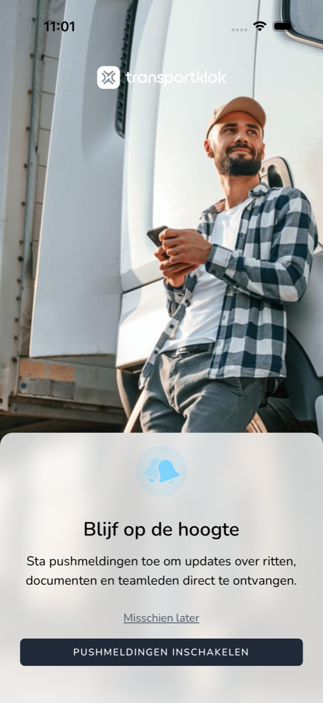

{/* translated-from: nl/workforce/app/push-notifications.mdx sha256:411d08cec7befaf6239f0ed999992cd57991126ebce8493c60b121f6830f2786 */}

## Pentru ce este această pagină

Cu notificările push primiți mesaje de la TransportKlok pe telefon, chiar și când aplicația este închisă. Aici citiți cum le activați.

## Captură de ecran

## Cine o poate folosi

- Orice angajat care folosește aplicația.

## Cum folosiți această pagină

1. După prima dumneavoastră autentificare vedeți **Fiți la curent**.
2. Atingeți **Activați notificările push.**
3. Telefonul vă întreabă dacă TransportKlok are voie să trimită notificări. Atingeți `Sta toe` (pe Android: **Permiteți**).

Dacă doriți să hotărâți mai târziu, atingeți **Poate mai târziu**.

## Câmpuri

| Buton | Ce se întâmplă |
|------|----------------|
| **Activați notificările push.** | Telefonul vă cere permisiunea pentru notificări. |
| **Poate mai târziu** | Continuați fără notificări. Aplicația întreabă din nou mai târziu. |

## Ce se întâmplă după aceea

- Cu permisiune, primiți pe telefon notificări de la TransportKlok.
- Dacă ați ales **Poate mai târziu**, aplicația întreabă din nou după un timp cu `Push notificaties`.

## Limitări

- Dacă ați refuzat notificările în întrebarea telefonului dumneavoastră, le activați din nou doar în setările telefonului, la TransportKlok. Aplicația afișează atunci `Push notificaties uitgeschakeld` ca reamintire.
