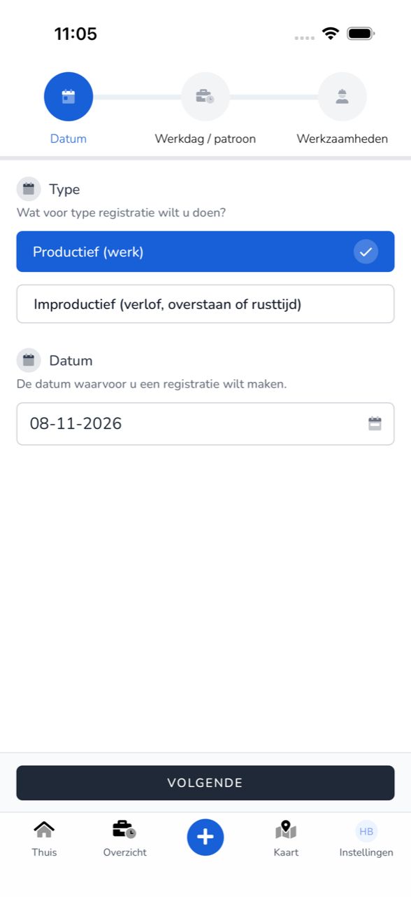
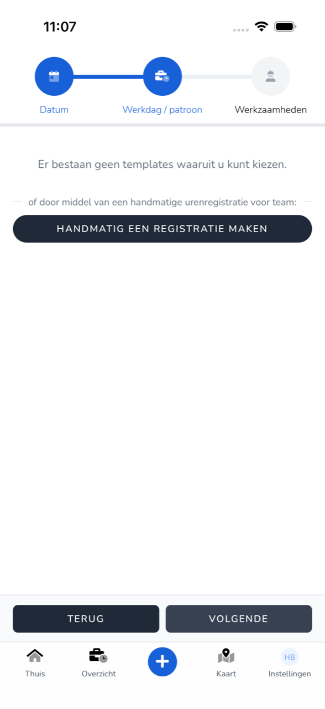
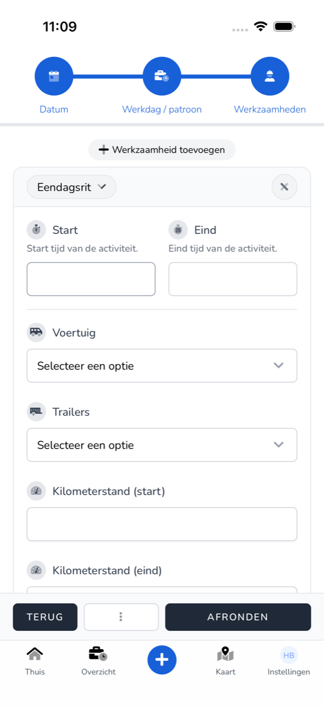

{/* translated-from: nl/workforce/app/register-work.mdx sha256:414f6947066e36516b2f0109ebf6a702ca3e8654cddc7529d89297ba620a3b0e */}

import { Hint } from '/snippets/hint.jsx';

## Pentru ce este această pagină

Aici înregistrați în aplicație ce ați făcut într-o zi: activitățile, orele și datele cursei dumneavoastră.

## Captură de ecran

## Cine o poate folosi

- Orice angajat care folosește aplicația.

## Cum folosiți această pagină

1. Pe **Acasă**, atingeți **Înregistrează munca**, sau jos `+`.
2. La **Tip**, alegeți **Productiv (muncă)**.
3. Atingeți **Dată** și alegeți ziua. Atingeți **Salvează** și apoi **Următor**.
4. La **Zi de lucru / model**, alegeți un șablon sau atingeți **Creați o înregistrare manuală** și alegeți echipa dumneavoastră. Atingeți **Următor**.
5. La **Activități**, atingeți **Adăugați activitate** și alegeți ce ați făcut, de exemplu **Cursă de o zi**.
6. Completați câmpurile activității. Adăugați, dacă este nevoie, mai multe activități.
7. Completați **Pauză (minute)**, eventual o **Notă**, și adăugați **Semnătură**.
8. Atingeți **Finalizați**.

## Câmpuri

| Câmp | Ce completați |
|------|--------------|
| **Tip** | **Productiv (muncă)** pentru orele lucrate. Pentru concediu alegeți **Neproductiv**, consultați [Înregistrarea concediului](/ro/workforce/app/register-leave). |
| **Dată** | Ziua înregistrării. În calendar alegeți o **Zi**, o **Perioadă** sau **Zile** separate. |
| **Început**, **Sfârșit** | Ora de început și de sfârșit a activității. |
| **Vehicul**, **Remorci** | Vehiculul și remorcile cu care ați condus. |
| **Kilometraj (început)**, **Kilometraj (sfârșit)** | Kilometrajul la plecare și la sosire. |
| **Numărul cursei**, **Combustibil alimentat**, **AdBlue alimentat**, **Taxă de drum** | Datele cursei dumneavoastră. |
| **Notă** | O observație la înregistrare. |
| **Pauză (minute)** | Pauza dumneavoastră în minute. |
| **Semnătură** | Puneți semnătura cu degetul. |

<Hint kind="grey">Ce câmpuri vedeți și care sunt obligatorii depinde de activitate și de ce a setat angajatorul dumneavoastră pentru echipa dumneavoastră.</Hint>

## Ce se întâmplă după aceea

- Înregistrarea se află în [Prezentare generală](/ro/workforce/app/overview) și așteaptă aprobarea angajatorului dumneavoastră.
- Dacă lipsește ceva, vedeți sub câmp ce mai trebuie să completați, de exemplu „Completați o oră de început."

## Limitări

- Dacă nu ați terminat încă, atingeți `⋮` și **Salvați ca ciornă**. Cu `Opnieuw beginnen` începeți înregistrarea de la capăt.
- Dacă perioada de salarizare a acelei zile este deja procesată, vedeți „Această înregistrare nu poate fi modificată deoarece perioada de salarizare a fost deja aprobată sau procesată." <Hint kind="yellow">Contactați atunci angajatorul dumneavoastră.</Hint>
