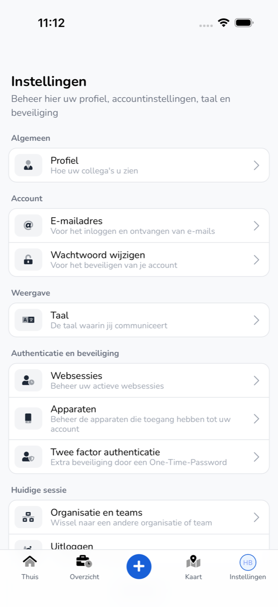
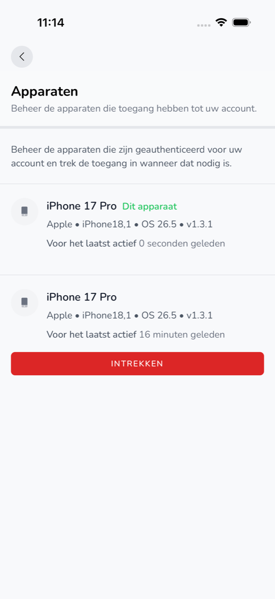

{/* translated-from: nl/workforce/app/settings.mdx sha256:c5a84b155d2486c3bd78343bb76d08c1966b85f750fc0c7d5f698368e0d7341f */}

import { Hint } from '/snippets/hint.jsx';

## Pentru ce este această pagină

În **Setări** gestionați profilul, contul, limba aplicației și securitatea contului dumneavoastră.

## Captură de ecran

## Cine o poate folosi

- Orice angajat care folosește aplicația.

## Cum folosiți această pagină

1. Atingeți jos **Setări**.
2. Atingeți elementul pe care doriți să-l modificați.
3. Modificați-l și atingeți **Salvează**.

## Câmpuri

| Element | Ce faceți acolo |
|-----------|-----------------|
| **Profil** | Alegeți sau eliminați **Fotografie de profil** și modificați **Nume**. |
| **Adresă de e-mail** | Modificați adresa de e-mail cu care vă autentificați. |
| **Schimbă parola** | Completați și confirmați **Parola curentă** și o **Parolă** nouă. |
| **Limba** | Alegeți limba aplicației: Nederlands, English, Deutsch, Polski sau Română. |
| **Sesiuni web** | Cu **Deconectați sesiunile din alte browsere** vă deconectați peste tot în altă parte. |
| **Dispozitive** | Telefoanele care au acces la contul dumneavoastră. Cu **Revocați** eliminați un telefon. |
| **Autentificare în doi pași** | Cu **Activați** activați autentificarea în doi pași. |
| **Organizația și echipele** | Alegeți o altă organizație. Consultați [Organizații și invitații](/ro/workforce/app/organizations). |
| **Aplică actualizarea** | Porniți acum o versiune nouă a aplicației care a fost deja descărcată. |
| **Deconectare** | Vă deconectați de pe acest telefon. |

## Ce se întâmplă după aceea

- După **Salvează** vedeți imediat modificarea în aplicație.
- După **Deconectare** vedeți din nou **Bine ai revenit.**

## Limitări

- O parolă nouă are cel puțin 8 caractere, cu cel puțin 1 literă mare, 1 cifră și 1 caracter special.
- Pentru **Sesiuni web**, **Dispozitive** și **Autentificare în doi pași**, confirmați mai întâi identitatea cu Face ID, Touch ID sau amprenta dumneavoastră. <Hint kind="yellow">Dacă nu ați configurat aceasta pe telefon, vedeți „Verificare biometrică necesară" și nu puteți modifica aceste elemente în aplicație.</Hint>
- **Aplică actualizarea** îl vedeți doar dacă o versiune nouă este pregătită.
