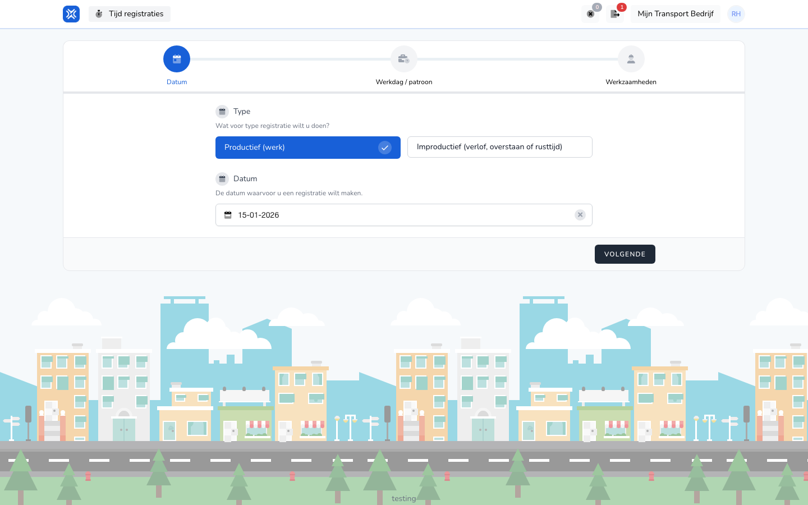

{/* translated-from: nl/workforce/hour-management/time-registrations/create.mdx sha256:db4596a342a4f6406a64653f37e8a7002c6601071d5be26c2518167d65f4b18d */}

## Pentru ce este această pagină

Cu această pagină introduceți pas cu pas o înregistrare nouă a timpului de lucru.

## Ce puteți face aici

- Alegeți o dată.
- Alegeți o zi de lucru sau un model.
- Completați activități.

## Captură de ecran

## Ce vedeți pe pagină

- Un formular în mai mulți pași.
- Pași clari în introducerea datelor.
- Câmpuri care se schimbă la fiecare pas.

## Cum folosiți această pagină

1. Deschideți **Înregistrare nouă**.
2. Completați pașii în ordinea de pe ecran.
3. Verificați ce ați introdus la fiecare pas.
4. Salvați înregistrarea când totul este corect.

## Ce se întâmplă după aceea

- Înregistrarea dumneavoastră apare în prezentarea generală.
- Totalurile dumneavoastră pentru perioadă sunt actualizate.

## Important de știut

- Lucrați calm, pas cu pas.
- Verificați cu atenție suplimentară data și activitățile introduse.

## Pagini conexe

- Prezentarea generală a înregistrărilor timpului de lucru
- Modificarea înregistrării timpului de lucru

