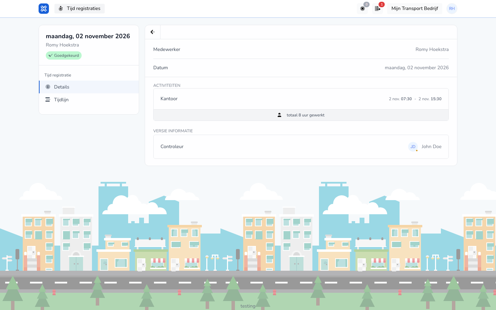

{/* translated-from: nl/workforce/hour-management/time-registrations/details.mdx sha256:7e34bd81d4100dc1226c633b2f917bc9bee9e93f97557dd87703f1f2d76384e8 */}

## Pentru ce este această pagină

Pe această pagină vizualizați conținutul unei înregistrări existente.

## Ce puteți face aici

- Citiți o înregistrare.
- Verificați dacă datele introduse sunt corecte.

## Captură de ecran

## Ce vedeți pe pagină

- Detaliile unei înregistrări.
- Datele completate ale acelei înregistrări.

## Cum folosiți această pagină

1. Deschideți o înregistrare existentă din prezentarea generală.
2. Citiți datele cu calm.
3. Treceți la modificare doar dacă trebuie modificat ceva.

## Ce se întâmplă după aceea

- Știți dacă înregistrarea dumneavoastră este corectă sau mai trebuie modificată.

## Important de știut

- Folosiți această pagină mai ales pentru verificare.
- Modificați ceva abia când știți sigur ce este greșit sau s-a schimbat.

## Pagini conexe

- Prezentarea generală a înregistrărilor timpului de lucru
- Modificarea înregistrării timpului de lucru
- Cronologia înregistrării timpului de lucru

