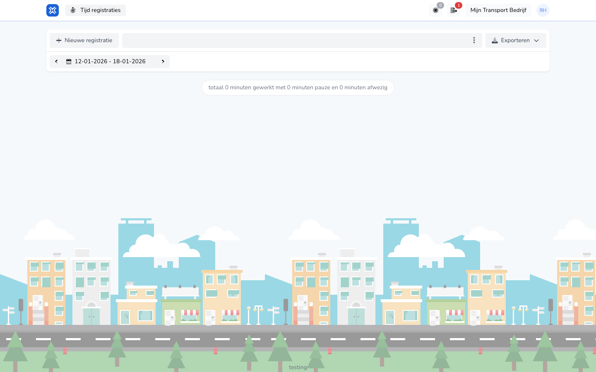

{/* translated-from: nl/workforce/hour-management/time-registrations/overview.mdx sha256:b3e5f1201fa9aeae533b47bfa3c8fae5be8a988fb9de9791bd6b19240aa0f4e0 */}

## Pentru ce este această pagină

Aici vedeți propriile înregistrări ale timpului de lucru și porniți o înregistrare nouă.

## Ce puteți face aici

- Vizualizați înregistrările dumneavoastră.
- Creați o înregistrare nouă.
- Vedeți totalul minutelor lucrate.

## Captură de ecran

## Ce vedeți pe pagină

- Butonul **Înregistrare nouă**.
- O alegere a perioadei.
- Un rezumat al minutelor lucrate și absente.

## Cum folosiți această pagină

1. Deschideți prezentarea generală a înregistrărilor timpului de lucru.
2. Verificați mai întâi dacă este selectată perioada potrivită.
3. Folosiți **Înregistrare nouă** dacă doriți să adăugați ceva.

## Ce se întâmplă după aceea

- Vedeți imediat totalul actual pentru perioada aleasă.
- Înregistrările noi reapar apoi în această prezentare generală.

## Important de știut

- Acest ecran este destinat propriei dumneavoastră înregistrări a muncii.
- Verificați întotdeauna dacă vă uitați la săptămâna potrivită.

## Pagini conexe

- Crearea unei înregistrări a timpului de lucru
- Detaliile înregistrării timpului de lucru

