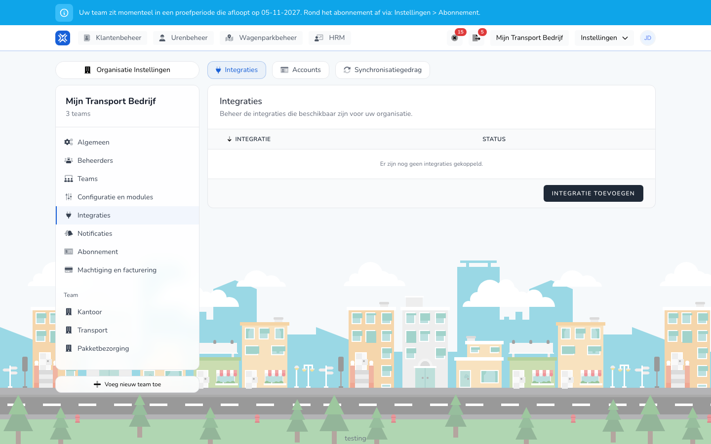

import { Hint } from '/snippets/hint.jsx';

## Waar deze pagina voor is

Op het tabblad **Integraties** koppelt u TransportKlok aan uw salarispakket of uw telematicasysteem. Een koppeling gebruikt een account dat u eerst aanmaakt bij [Accounts](/settings/organization/integrations/accounts).

## Schermafbeelding

## Wie dit mag gebruiken

- Een beheerder of manager van de organisatie.
- Een salariskoppeling vraagt de module **Salarismutaties**. Een GPS-koppeling vraagt de module **Wagenparkbeheer**, met telematica aan. <Hint kind="yellow">Staat telematica niet aan voor uw organisatie, dan ziet u bij het koppelen: "Telematica is niet ingeschakeld voor deze organisatie. Schakel eerst telematica in voordat je een koppeling maakt."</Hint>
- De koppelingen zijn in bèta. <Hint kind="grey">U ziet ze alleen als uw organisatie meedoet aan het bètaprogramma.</Hint>

## Zo gebruikt u deze pagina

1. Open **Instellingen** → **Organisatie Instellingen** → **Integraties**.
2. Klik op het tabblad **Integraties** op **Integratie toevoegen**.
3. Klik bij uw systeem op **Verbinden**.
4. Kies het **Account**, vul de overige velden in, zoals de **Werkgever** bij Nmbrs, en geef de koppeling een **Naam**.
5. Klik op **Verbinden**.
6. Vul op de pagina met instellingen in wat uw systeem nodig heeft en klik op **Instellingen opslaan**.

## Velden

| Veld | Wat u invult |
|------|--------------|
| **Account** | Het account waarmee de koppeling inlogt bij uw systeem. |
| **Naam** | De naam in het overzicht, bijvoorbeeld de naam van uw bv. |

Wat elk systeem vraagt en doet, staat op de pagina van dat systeem:

| Soort | Systemen |
|-------|----------|
| Salarispakket | [Nmbrs](/beheerders/personeelszaken/salariskoppelingen/nmbrs), [Loket.nl](/beheerders/personeelszaken/salariskoppelingen/loket), [AFAS Profit](/beheerders/personeelszaken/salariskoppelingen/afas), [Exact Online](/beheerders/personeelszaken/salariskoppelingen/exact-online) |
| Telematica | [Webfleet](/beheerders/wagenparkbeheer/koppelingen/webfleet), [Samsara](/beheerders/wagenparkbeheer/koppelingen/samsara), [Geotab](/beheerders/wagenparkbeheer/koppelingen/geotab), [FleetGo](/beheerders/wagenparkbeheer/koppelingen/fleetgo), [Linqo](/beheerders/wagenparkbeheer/koppelingen/linqo), [CO3](/beheerders/wagenparkbeheer/koppelingen/co3), [Verizon Connect](/beheerders/wagenparkbeheer/koppelingen/verizon-connect) |

## Wat er daarna gebeurt

- De koppeling staat in het overzicht op **Verbonden**.
- Welke gegevens de koppeling ophaalt of verstuurt, zet u aan bij [Synchronisatiegedrag](/settings/organization/integrations/capabilities).
- Ontbreken er rechten of instellingen, dan ziet u een melding met **Opnieuw autoriseren** of **Instellingen openen**.

## Beperkingen

- Een koppeling loskoppelen doet u met **Loskoppelen**. Vink **Ook het onderliggende OAuth-account loskoppelen.** aan om ook het account te verwijderen. <Hint kind="red">Een losgekoppelde koppeling haalt niets meer op en verstuurt niets meer. Om weer te koppelen maakt u de koppeling opnieuw.</Hint>
